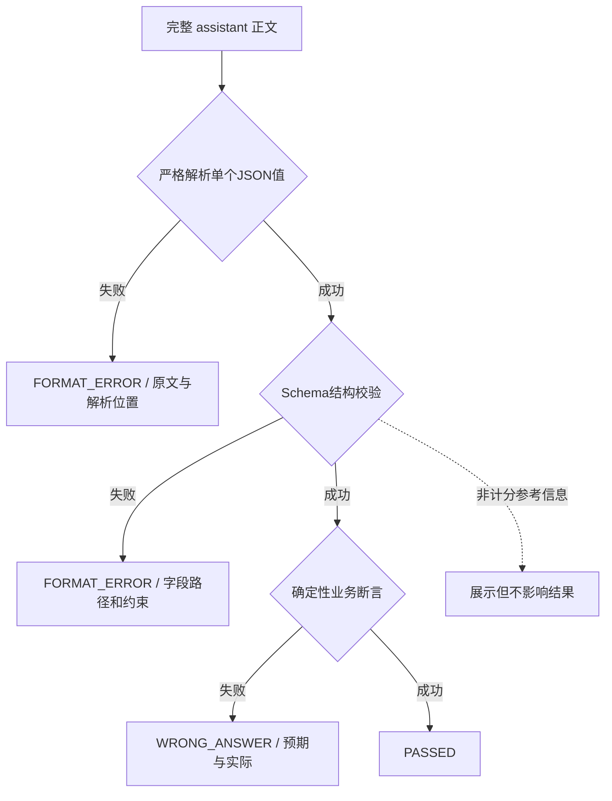

# 严格 JSON 判题体系

> 来源：原方案 v0.2 第 5 节。拆分保留原意；示例不是已经实现或验证的功能。

三个完整样题及题库维护规范见 [PROBLEMS](PROBLEMS.md)。

## 5.1 统一判题契约

所有题目必须能以明确 JSON 契约判题。不要求 JSON 文本的缩进、字段顺序、Unicode 转义写法相同，但必须整段是一个合法 JSON 值（每道样题根类型为 object）。允许标准 JSON 首尾空白；拒绝 Markdown 围栏、解释前缀/后缀、多段 JSON、尾随逗号、注释、非标准数值和重复对象键。不要用正则从一段回答中提取第一个 `{...}`，不要自动 trim 掉非 JSON 内容或修复语法。先由适配器提取最终 assistant 正文，不把上游响应外壳本身当作答案。浏览器只在正常结束后提交正文判题。手动粘贴由用户声明正文完整，记录 D0 来源。



解析建议：Jackson 启用重复键检测与 trailing tokens 检查，关闭 lenient JSON 选项，配置输入长度、嵌套深度、字符串与数值长度上限。JSON Schema 固定一个明确 draft（推荐 2020-12，库版本须验证）；只加载本地受信题目资源，不允许 validator 远程获取 `$ref`。Schema 管结构、类型、必填、枚举、数值范围；业务断言管与具体样例对应的答案。根对象附加字段是否允许由每题明确配置。不要默认类型强制转换：字符串 `"true"` 不等于布尔 `true`，金额字符串和数字按题目声明区分。

断言 DSL 只支持明确枚举的操作，例如 `equals`、`exists`、`nonBlank`、`arraySize`、`setEquals`、`uniqueBy`、`each`、`range`、`mapEquals`（使用受限 JSON Pointer，数组规则在 Java 中实现），不允许用户或远程题库执行任意 JavaScript/Python/SpEL/SQL。数值比较用 BigDecimal，字符串默认精确（如要 trim/大小写不敏感必须题目显式声明）；数组排序是否敏感由题目规定。规则由题目版本固定，业务规则不能由前端参数覆盖。首版不需要复杂的 JSONPath 脚本表达式；成熟库处理格式，少量自研白名单业务规则。

反馈结构示例：

```json
{
  "transportStatus": "COMPLETED",
  "verdict": "WRONG_ANSWER",
  "checks": [
    {"id": "json", "status": "PASS"},
    {"id": "schema", "status": "PASS"},
    {"id": "boundary-5", "path": "/cases", "status": "FAIL",
     "expected": {"length": 5, "expectedValid": false},
     "actual": {"length": 5, "expectedValid": true}}
  ]
}
```

规则失败要显示可操作的具体信息；通过的字段可以收起，未通过规则展开。显示完整模型原始回复并提供复制，格式化视图仅对解析成功正文作为额外展示，不代替原文。任何 `referenceOnly` 字段均不阻止通过，必须明确标为未自动评价。

模型波动：同一 Prompt 和输入可能因模型版本、采样、网关路由、上下文或推理差异得到不同结果。平台只判定本次运行，记录客户端报告或用户声明的模型 ID、题目版本、用例、参数和来源；没有跨模型统一准确率承诺。若网关支持，可将 temperature 设置为较低且公开的默认值，但不能保证确定性，也不能在模型不支持时暗中替换；题库不依赖模型专有约束生成。默认公开样例，不做隐藏测试，不把多次通过合成 Prompt 泛化认证。一次运行处理一个公开用例。多个用例分别执行，明确每次调用可能消耗用户额度。
