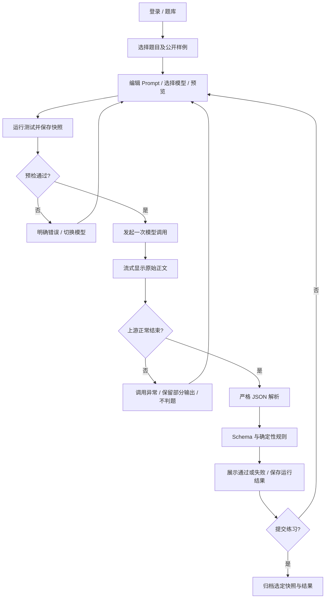
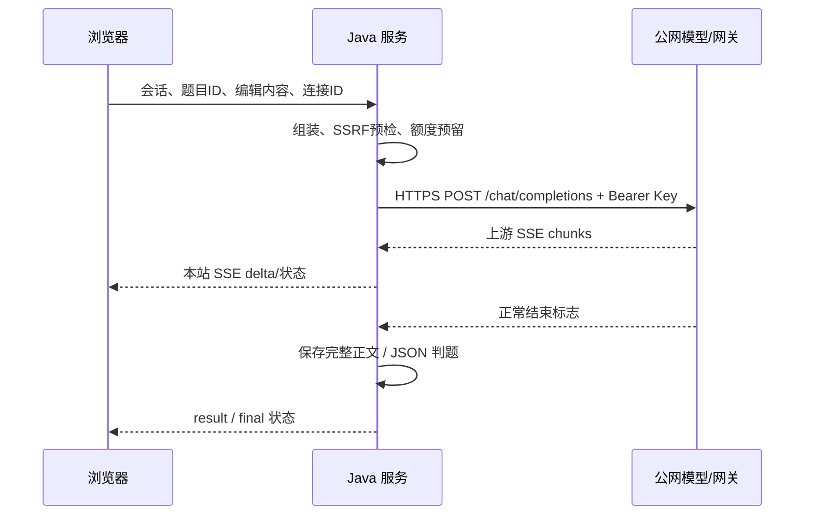
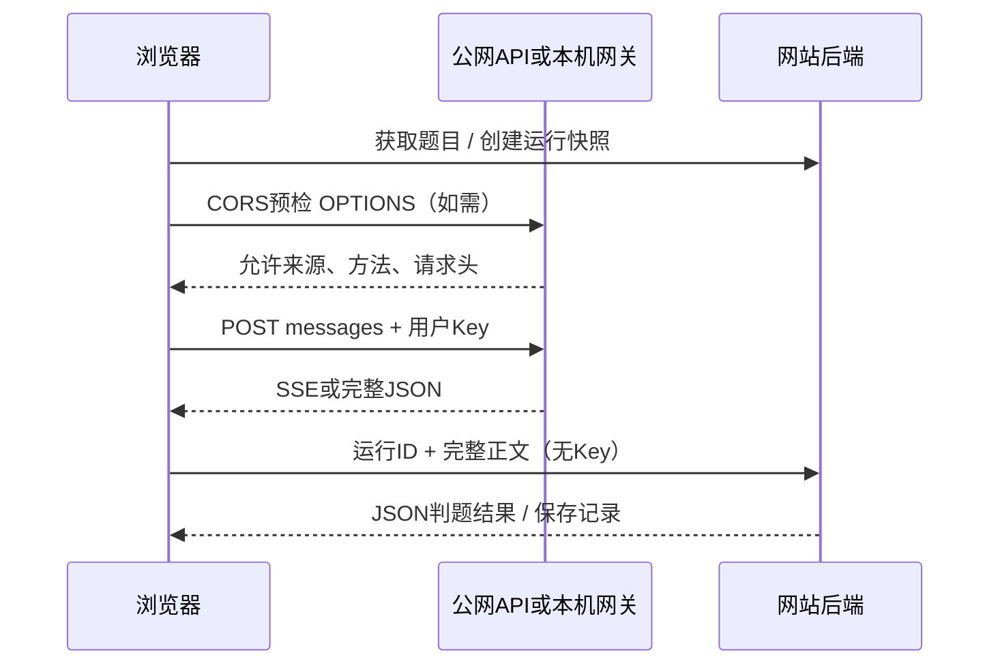
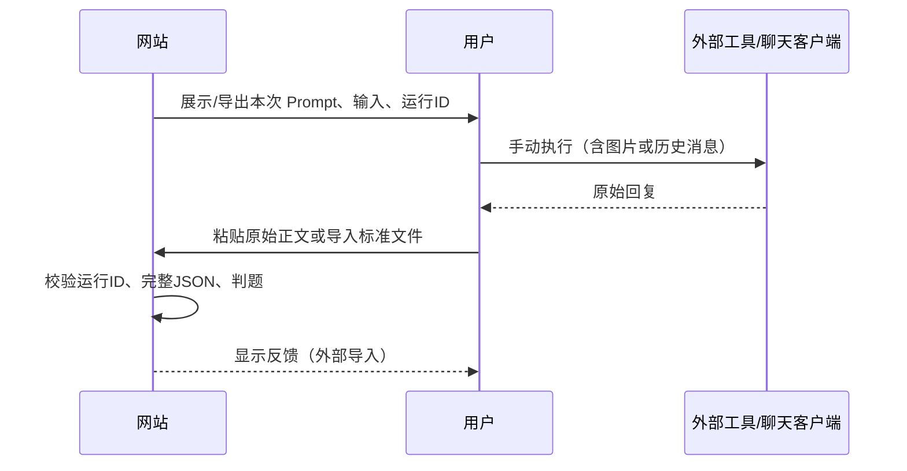
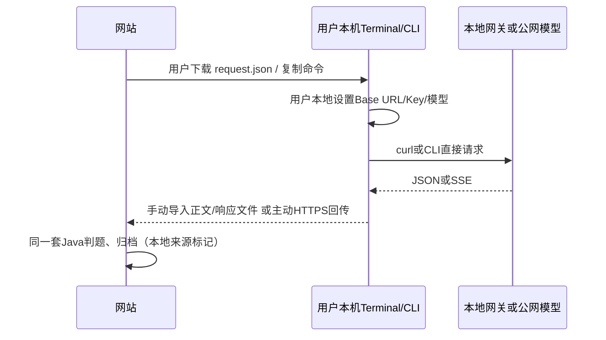
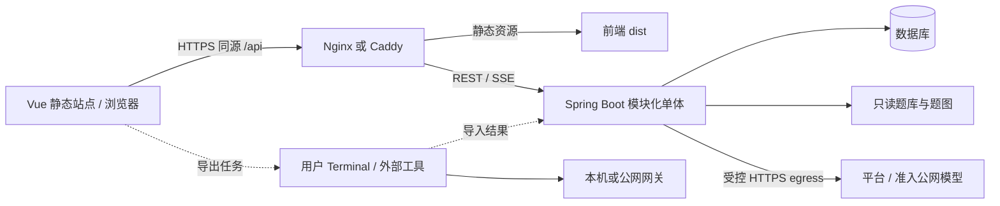
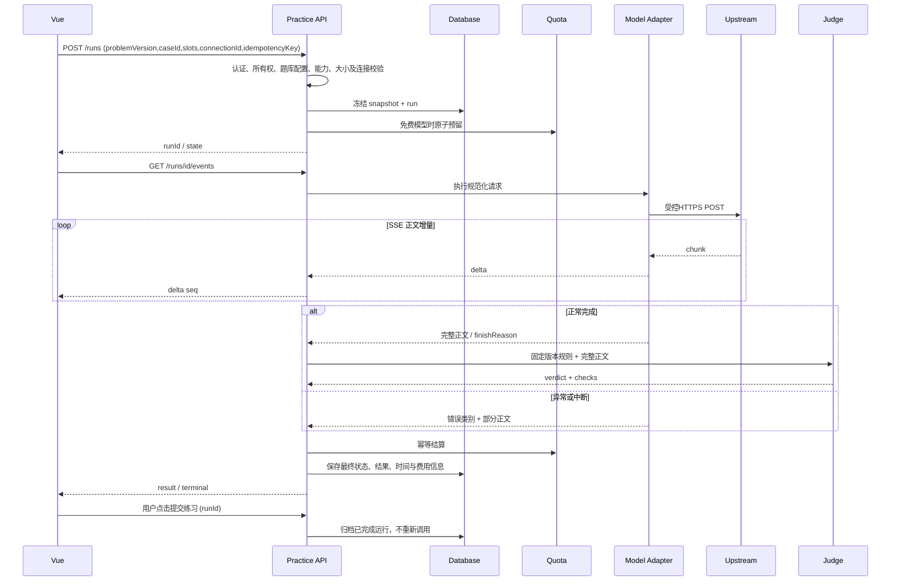
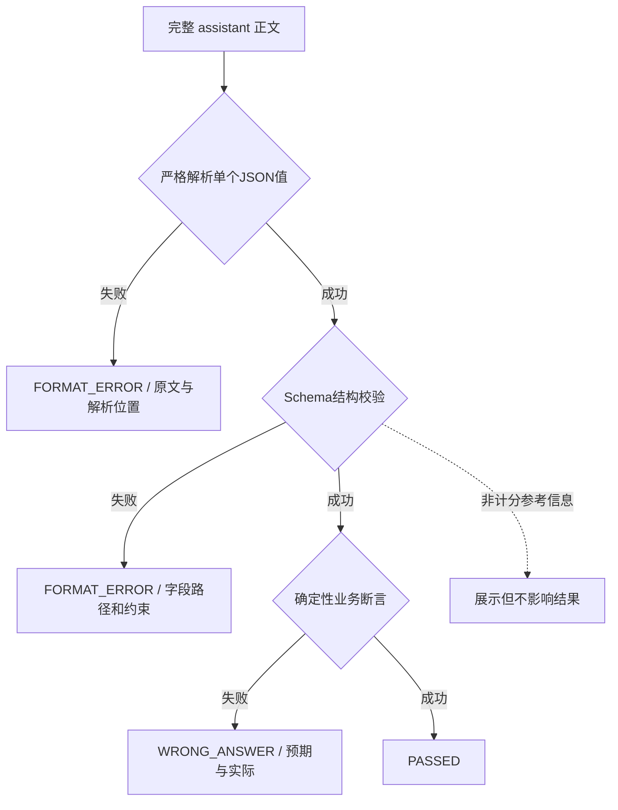

# Prompt Practice｜产品与技术方案

> 版本：v0.1 · 开发前评审稿 · 2026-11-25  
> 状态：待确认，不进入开发  
> 目标环境：2 vCPU / 2 GB RAM / 40 GB 系统盘；Java 后端，包名前缀 `cn.shiinapple`。  
> 交付说明：本文以可直接放入仓库的 Markdown 编写；所有选型、阈值与目录均为建议，除明确标记的已确定需求外不视为最终决策。当前未获得现有待办项目源码，未核验 `code/frontend/src/color-tokens.css` 的具体变量，也未进行真实网关调用或性能压测。

## 目录

1. 首版建议与完整做题流程
2. 模型接入方案、接口、安全与失败处理
3. Java 模块、技术选型、数据与部署设计
4. 做题页及三个主要页面交互设计
5. JSON 判题体系与三道完整样题
6. 开发验收、实施边界与参考资料
7. 待拍板决策清单

---

# 1. 首版建议与完整做题流程

## 1.1 产品定位

做一个面向 Prompt 初学者和开发者的、可重复试验的练习平台，而不是聊天机器人、AI 自动编写 Prompt 工具或完整的模型网关。借鉴 LeetCode 的题目说明、编辑区、运行、测试结果、提交记录分离的交互，但不照搬算法竞赛的隐藏用例、排名及代码执行沙箱。平台验证的是用户这一份 Prompt 在指定模型、指定输入下产生的本次回复，并不声称证明 Prompt 对所有模型与输入都有效。

核心原则：用户自己修改 Prompt；平台不偷偷加上修复 JSON 的指令、不使用上游强制 JSON 模式、不二次调用 AI 评审。完整文本输出通过严格 JSON 解析和确定性规则即可通过。题库由项目所有者人工收集、审核、发布；三道样题仅用于验证框架，Claude 讲座原题到手后作为首个正式验收案例，不预设其具体内容。

## 1.2 推荐首版（待批准）

| 领域 | 首版范围 | 暂不做 |
|---|---|---|
| 账户 | 邮箱+密码、登录会话、基础设置 | OAuth、多租户、社交功能 |
| 题库 | 中英文、分类、难度、公开样例、题目版本；人工维护文件 | 在线出题后台、隐藏测试、题库社区 |
| 在线执行 | 平台默认模型 + 用户自带公网上游（管理员域名准入）；Java 后端中转、SSE | 任意公网地址直接放开；原生 Anthropic/Gemini/Responses 全协议 |
| 本地执行 | 导出请求/示例命令，Terminal 或已有工具运行，导入正文或响应 JSON | 网页自动拉起 Terminal、安装常驻代理；自动回传 CLI 可作为 v1.1 |
| 接口 | OpenAI-compatible Chat Completions；支持普通文本与经验证的图片输入 | 工具调用循环、MCP、结构化输出强制模式 |
| 判题 | 完整 JSON + JSON Schema + 白名单确定性断言 | LLM-as-judge、任意 JS/Python 判题脚本 |
| 记录 | 草稿、每次运行快照、调用故障、手动提交归档 | 排行、模型横评、成绩认证 |
| 默认模型 | 显示名 DeepSeek Lite（实际 model ID 和能力由部署网关配置）；3 次免费调用 | 默认假定任意 DeepSeek 型号支持图片；额外视觉免费模型未确认 |

推荐路线不是要求用户只能用网站的 Key。平台默认模型降低新用户门槛，公网 BYOK 方便日常使用，本地 Terminal 使用户能使用自己已经配置好的网关且 Key 无需交给网站。后两者互补。**首版不把浏览器直连作为必选依赖，也不把任意 URL 的服务端转发作为默认开放能力。**

## 1.3 一次完整做题流程

1. 用户注册、验证邮箱（推荐）、登录；进入题库，选择「开发 / 需求转测试用例」。
2. 做题页左侧阅读目标、固定输入和输出约束，右侧出现一个可编辑 Prompt，顶部固定模型选择器显示「DeepSeek Lite · 免费剩余 3 次」。
3. 用户修改 Prompt，切换公开样例，必要时打开「请求预览」查看最终 messages。题目指定的变量与输入不能被篡改。
4. 点击「运行测试」：冻结题目版本、样例 ID、编辑内容、组装结果、模型配置引用，保存不可变快照；服务端校验会话、输入大小、模型能力、免费额度、并发限制。
5. 通过预检后 Java 发起模型请求；下方原始输出区流式出现模型正文，界面显示正在运行、停止按钮、已用时间。不对半截 JSON 做判题。
6. 上游按协议正常完成后，Java 对完整正文进行严格解析、Schema 校验及规则检查。显示通过/格式错误/答案错误/调用异常，列出精确失败路径和预期值。默认只跑当前选择的一个公开样例；一次在线运行至多一次上游生成调用。
7. 用户编辑并再次运行，历史保留每次实际快照；也可换模型重新运行。免费用尽不影响 BYOK 或导入。
8. 点击「提交练习」将已经完成判题的某次运行归档（可通过，也可未通过，明确标记）；不再次请求模型、不扣额度。如果当前编辑与运行快照不同，提示先运行或明确归档旧版本，不悄悄提交新草稿。



# 2. 模型接入方案

## 2.1 路线 A：Java 后端中转



浏览器只访问本站同源接口，不受上游浏览器 CORS 限制。服务端负责鉴权、超时、统一错误、判题、额度和运行快照。上游和本站分别是两个 HTTP 连接，建议解析上游 SSE，再以本站规范的 SSE 转发字符增量，而不是盲目字节透传上游所有事件。这样既保留流式体验，又不会把上游错误、敏感响应头、推理字段和厂商私有信息原样发送给页面。

**信任边界：** 用户需信任网站运营者、服务器及运维链路。即便 API Key 加密入库，Java 进程调用上游时也需要使用明文，恶意运营者或被攻陷的进程可以取得它。TLS 和加密存储不能把服务端变成零信任。网关也能读取请求内容，用户须确认网关可信、条款允许调用。

云端后端无法直接访问用户电脑 `127.0.0.1`、`localhost` 或普通局域网 IP；这些地址对云端来说指向云端机器自身或其网络。公网网关必须真实可路由；不要为了兼容本机而放开服务端私网访问或要求用户把本地无认证端口暴露到公网。隧道/VPN 可改变可达性，但需要独立身份认证、安全设计和明确授权，不建议首版。

## 2.2 路线 B：浏览器直连



适合明确支持浏览器调用的上游，或用户能控制 CORS 和本地网络权限的网关。Key 可仅保存在前端内存并由用户填写，不上传本站；但仍存在于浏览器运行时明文、网络调试工具及 JS 可访问空间。站点脚本、XSS、恶意浏览器扩展、被污染的第三方依赖或网站后续更新可能读取。它降低服务端存储泄露面，不代表用户不需要信任网站前端。不要把 Key 存在 localStorage、URL、前端构建变量或埋点中；即便用 IndexedDB 加密，运行时也能解密，不能作为安全承诺。

浏览器直接 POST 带 `Authorization` 和 `Content-Type: application/json` 通常触发 OPTIONS 预检。上游必须允许实际站点 Origin、POST/OPTIONS、Authorization 和 Content-Type；若不使用跨域 Cookie，`credentials: omit`。不得用 `no-cors` 规避，opaque 响应无法读取；也不建议用户关闭浏览器安全机制。SSE 使用 fetch 读取 response.body，不采用仅支持 GET 且难携带自定义 Authorization 的原生 EventSource 直连上游。

HTTPS 页面请求普通公网 HTTP 通常会被 mixed content 拦截。`localhost` / loopback 具特殊可信来源处理，但不能笼统宣称 HTTPS 一定能访问任何 HTTP 本地地址。Chrome 等浏览器实施 Local Network Access 权限控制，实际能否访问与浏览器版本、目标地址分类、权限、CORS、安全上下文及网关实现相关；Firefox/Safari 不应默认具有同等行为。禁止把局域网设备与普通公网 HTTP 混为一谈。需测试目标浏览器及实际网关。CORS 或权限拦截常在 JS 侧表现为笼统网络错误，不能假装能准确诊断；页面提供排查步骤和 Terminal 备选。

浏览器直连回传结果由用户控制，服务端不能证明正文来自真实模型。适合私人练习，不可用于认证成绩；客户端也不能使用平台运营方的免费 Key。

## 2.3 路线 C：外部工具执行



适合网页聊天、已有客户端和特殊协议模型。平台可以导出角色、消息和输入，不必知道外部工具的 API Key；用户手工执行并导入。复制时应只复制最终正文而非聊天窗口装饰、推理内容或 Markdown 包装之外的内容；导入不自动剥离模型实际生成的代码围栏。

自动取得结果的必要条件：外部工具有可调用的任务创建/查询接口或能执行插件/脚本，能将本站 run ID 与其 job ID 对应，且有授权读取完整结果。若支持 webhook，由本站生成一次性回传凭证，外部工具向 HTTPS 回调端点提交 job ID、正文、状态；验证签名、时间窗口、重放防护、大小和任务所属账号。若只有任务查询接口，本站必须拥有查询授权且接口公网可达，采用有限轮询而非无期限等待。仅有网页 UI、聊天历史或本机日志时，不存在通用的回调能力；任务 ID 自身不会让本站访问外部数据，只能人工导入，除非另行集成有授权的连接器。不可要求上传整个客户端配置、历史或账号登录令牌。

## 2.4 路线 D：用户本机 Terminal / CLI 执行



### 核心判断

这条路线可行，而且特别适合 CC Switch、Magpie 等本地模型网关。HTTP 客户端不受浏览器 CORS、mixed content 或网页 Local Network Access 限制，`127.0.0.1` 就是用户本机。远程服务器只负责题库与判题，不拿用户模型 Key，不必反向连接用户电脑，也不承担这部分任意网关地址的 SSRF 风险。Magpie 与 CC Switch 的实际暴露路径、协议、端口、鉴权模式因配置和版本而异，不硬编码品牌端口；从工具提供的可兼容 Chat Completions 配置读取，由用户确认实际可用性。

限制：普通网站 JS 不能直接执行本机 shell、读取本机环境变量或无授权读取工具配置。浏览器里的 xterm.js 是终端显示组件，不是本地 shell 权限；如果把 Terminal 放在云端运行，仍访问不到用户本机，而且会引入远程命令执行风险。首版不做网页终端、任意 shell 执行或让用户运行 `curl | bash`。

### D0：无需安装的最小实现（建议首版）

网站导出已冻结的 `request.json`（含 model、messages、`stream:false`，不含 Key）；用户从本机工具取得 Base URL 与模型 ID，在下载对话框填模型 ID 或在本地修改请求文件。可复制下面示意命令。例子以 macOS/Linux POSIX 兼容终端为主；Windows PowerShell 应提供单独示例，而不是假定每个平台命令一致。

```bash
# 例：本机执行；实际地址以用户网关配置为准。
BASE_URL='http://127.0.0.1:PORT/v1'
# 在支持 read -s 的 shell 中输入密钥，不把真实Key写入历史命令。
# 以下是 Bash 示例；本地网关不要求鉴权时省略 Authorization 头。
read -r -s -p 'API Key: ' API_KEY; printf '\n'
# 请求体由网站导出，model 字段填真实ID。
# 用 stdin 传 Authorization 头，避免直接把 Key 展开到 curl argv。
printf 'Authorization: Bearer %s\n' "$API_KEY" | \
  curl --fail-with-body --silent --show-error \
    --connect-timeout 5 --max-time 180 \
    -H @- -H 'Content-Type: application/json' \
    --data-binary @request.json \
    "${BASE_URL%/}/chat/completions" -o response.json
unset API_KEY
```

说明：`PORT` 是占位符；不要关闭证书验证、跟随未知重定向或对不可信地址发送 Key。即使通过 stdin 传头，本机进程、内存、系统权限仍是信任边界。`response.json` 可能包含私人回复，妥善保管。应检查 curl 退出码、HTTP 状态和响应结构，不能把错误响应当作模型答案。成功且 `finish_reason` 正常时，网站导入工具解析外层响应 `choices[0].message.content`，把字符串原样交给严格判题器；也允许用户直接粘贴原始正文。导入响应文件不要上传原始 HTTP 头、Key 或完整日志。此命令只是实施示意，不表示当前网关已实测。

### D1：轻量本地 CLI 自动回传（建议 v1.1，可提前）

可复用成熟 HTTP 客户端与 CLI 参数解析库（若用 Java 可选 picocli；若希望免装 JVM 可评估 Go 单二进制，但不改变 Java 后端）。不必重新写模型网关。用户主动启动 CLI，CLI 在本地读取自己配置的地址/Key/model，从网站获取运行任务（题目版本、样例 ID、已组装消息、模型参数和图片资产）；调用模型、在终端展示增量，结束后主动向本站 HTTPS 上传 `runId + 原始正文 + finishReason + 声明模型ID + 错误状态`。Key 和本机 URL 不回传；可在网站中显示「等待本地结果」，轮询 run 状态或通过本站 SSE 接收 CLI 主动上传的增量（可后置）。

任务授权推荐短时有效、单次用途、绑定账号与 runId 的高熵 token；只允许提交该次结果，不允许访问账号其他资源。不把 token 放 URL 查询参数、命令行历史或公共日志，下载任务凭证文件需限制权限。重复回传幂等；过期/取消拒绝，允许用户手动重新授权。禁止自动获取 CC Switch/Magpie 内部凭证；仅使用用户显式提供的兼容 API。

### 本地判题还是服务器判题？

推荐本地调用、服务端判题：不发送 Key，只发送完整最终正文，复用同一 Java 规则，便于同步练习记录。也可以导出 Schema 和规则，在本地使用成熟验证库离线判题；优点是模型输入输出完全不经本站，代价是两份规则实现需要一致、服务端无法验证本地成绩。若回传仅 pass/fail，必须标注「本地自报」，不作为本站复算结果。若需要同页实时流式显示，CLI 须主动上报分块或使用受控本地桥接；仅 curl 导入的首版没有同页实时流式体验。

## 2.5 四种方式对照

| 对照项 | A Java 中转 | B 浏览器直连 | C 外部工具 | D 本机 Terminal |
|---|---|---|---|---|
| 请求发出位置 | 云端服务器 | 用户浏览器 | 外部工具 | 用户电脑 |
| Key 信任边界 | 本站服务端及上游 | 网站 JS/浏览器及上游 | 外部工具及上游 | 用户本地环境及上游 |
| 公网网关 | 可，需准入 | 可，需 CORS/HTTPS | 看工具 | 可 |
| 本机网关 | 默认不可达 | 有条件可达 | 可（本地工具） | 可 |
| CORS | 上游不受浏览器 CORS | 必须解决 | 通常无（取决于工具） | 无浏览器 CORS |
| SSE 同页 | 易统一实现 | 可但依赖网关 | 需专门集成 | 手动版无；CLI 可回传 |
| 平台免费额度 | 适合 | 禁止交付平台 Key | 不适合 | 不适合交付平台 Key |
| 结果可信来源 | 服务端观测上游 | 客户端可伪造 | 用户导入可改 | 客户端可伪造 |
| 服务端 SSRF | 高，必须防护 | 直连不产生此类中转 SSRF | 回调/轮询若存在需防护 | 本地请求不经云端 |
| 首版成本 | 中；安全成本最高 | 中；兼容测试高 | 低（手动） | 低（导入）；自动 CLI 中 |
| 典型使用者 | 新手/公网 BYOK | 信任站点 JS且上游支持跨域 | 已有聊天客户端 | 开发者/本地网关/不愿托管 Key |

首版建议 A + C/D0，统一页面状态与判题；B 和 D1 均保留扩展接口，优先级由实际用户画像决定。如果目标用户大多数本来就在 Terminal 使用网关，可将 D1 提升为首版，甚至暂时关闭服务端自定义网关，仅保留平台固定上游，这会显著收窄服务端安全面。

## 2.6 模型协议与连接配置

| 接口族 | 首版 | 说明 |
|---|---|---|
| OpenAI Chat Completions-compatible | 支持 | POST `{baseUrl}/chat/completions`；Bearer；messages；普通文本/SSE；图片按 content parts |
| OpenAI Responses | 后续 | `input` 与 typed events、结束事件、输出结构不同，不能将 Chat SSE parser 直接复用 |
| Anthropic Messages | 后续 | `system` 位置、消息内容块、鉴权头、SSE event 类型不同 |
| Gemini 原生 | 后续 | contents/parts、API Key 和响应格式不同 |
| 网关协议转换 | 条件支持 | 仅当网关实际暴露符合首版契约的 endpoint；不能凭品牌或 model 名推断 |

配置字段：名称、执行方式、协议、API Base URL（中转/直连适用）、模型 ID、Key（可选取决于本地/上游认证）、图片能力（未知/已声明/已验证支持/已验证不支持）、连接状态和最近检测时间。可选择多个连接；首版每次只用一个模型。平台连接只读、真实 Key 和网关地址不下发。默认界面展示 DeepSeek Lite，不将其当成经核实的上游型号。部署配置包含 `platform.baseUrl / modelId / supportsImage / secretRef / limits`。若网关实际 model ID 改动，旧记录保留真实调用 ID、上游返回 ID（若有）与配置版本。

Base URL 契约：用户填实际 API 前缀，例如 `https://gateway.example/v1` 或上游明确要求的无 `/v1` 前缀，不自动盲加 `/v1`。展示最终 endpoint 供用户核对；若填完整 `/chat/completions`，明确提示修正或按严格规则规范化，避免重复拼接。首版适配器固定路径后缀、方法与鉴权，不能由用户填写任意请求头/代理地址/回调地址。普通文本模式不传 `response_format: json_object` 或 JSON Schema 强制参数，不加 `tools`，不暗中修补用户 Prompt。

连接测试：先离线检查 URL/必填字段/协议/准入/网络类型；可选 GET `/models` 用来列模型，但不把 404 当作不可用，因为网关可能不支持列表。最终以一次短小 `chat/completions` POST 验证鉴权、所填 model、响应结构；单独可选 SSE 测试与使用固定小图的视觉测试。BYOK 测试可能产生费用，按钮旁提示；平台连接由运营者测试，不消耗用户的免费额度。文本测试成功不意味着图片或流式一定支持。每次运行仍重新检查安全条件，不能因为过去测试成功就跳过。保存与测试可分开，状态显示未测试、可用、不可用、待管理员准入。

典型提示：「401：上游拒绝认证，请检查 Key 或鉴权方式」；「404：模型或接口路径不存在，请检查 Base URL 和模型 ID」；「此地址是本机网关，云端不能访问，请改用本地执行」；「浏览器未能读取跨域响应，可能是 CORS、权限或网络问题」；「已通过文本连接测试，图片能力尚未验证」。上游的通用错误按证据描述，不武断分类。

## 2.7 SSE、断点状态与故障分类

建议 `POST /api/runs` 创建并启动运行，返回 runId；`GET /api/runs/{id}/events` 订阅本站 SSE（同源 Cookie，或 fetch 流）；`GET /api/runs/{id}` 获取最新持久状态，`POST /api/runs/{id}/cancel` 主动停止。避免 GET 订阅重连导致重复生成；POST 使用客户端 idempotency key，服务端唯一约束，重复 POST 返回同一 run。对浏览器和服务端并发建立有界任务池或受限异步执行器，不能让每个用户无限占用线程。

SSE 事件契约（示意）：`meta {runId, modelId}`、`delta {seq, text}`、`status {state}`、`result {verdict, checks}`、`terminal {state, errorCode}`；心跳为 SSE comment 或专门事件。支持 UTF-8 跨网络 chunk、多个 data 行、CRLF、空行、心跳、厂商额外字段；解析 `choices[0].delta.content` 并单独处理 `finish_reason`，不得把 reasoning_content/tool_calls 当作正文。只请求一个 choice；正常完结按适配器规定（典型 Chat Completions 需正常 finish_reason 与 `[DONE]`）；明确兼容性差异可配置，不能仅凭 TCP EOF 或 JSON 碰巧闭合判定成功。`finish_reason=length`/content_filter/tool_calls、缺少正文、错误事件属于不完整/异常而非正常通过。

上游连接中断与网页断开是不同情况：

- 上游提前结束：立即保存已接收正文、字符数与 UTF-8 字节数、最后事件序号、错误类别，标记 `INTERRUPTED`；页面提示「响应中断，已收到部分内容」，保留原始片段，不判题；不自动重新调用模型。
- 网页关闭或网络断开：服务端在明确上限内可继续消费上游并完成判题；前端回来凭 runId 查状态或重连（Last-Event-ID/seq）；首版可用最新完整快照+后续增量实现，不要求永久事件日志。服务端在订阅前已收到内容也能恢复，使用快照水位号和有序增量防止重复/漏字。
- 服务进程崩溃：启动恢复把超过运行期限且未结算的记录标记中断/费用待确认；保留最近持久化的部分正文，不声称能恢复上游生成；重试必须创建新 run。
- 主动停止：`CANCELLED`，尽量取消上游 HTTP Call；不判题，部分内容保留，上游可能已计费。

内存中有界缓存（每 run 最大输出示例 64 KiB），每 1–2 秒或每 4–8 KiB 持久化一次，最终状态事务落库后推送 terminal。反向代理禁用该 SSE 路径缓冲和不必要压缩、设置合理 idle timeout 与心跳；上游、应用、代理分别配置超时。服务端返回流式 HTTP 200 后无法改为 HTTP 500，所以后续错误用业务终止事件表示；HTTP 状态只覆盖流开始前的错误。

| 状态/错误码（建议） | 触发依据 | 页面和记录 |
|---|---|---|
| QUEUED / RUNNING | 预检已通过/调用中 | 流式输出、停止、计时；限制重复点击 |
| CONNECT_TIMEOUT / CONNECT_FAILED | DNS、TCP/TLS 建连超时或失败 | 区分网络阶段，提供 Base URL 排查 |
| RESPONSE_TIMEOUT | 等待首字节或流空闲超时 | 说明是等待响应；有部分内容则保留 |
| INTERRUPTED | 上游提前 EOF 或传输中断 | 保留已收正文；不判题 |
| UPSTREAM_RATE_LIMIT | 429 + 明确限流错误码 | 显示限流，若有 Retry-After 提示，不自动重试 |
| UPSTREAM_QUOTA | 429 等 + 明确余额/额度错误码 | 提示检查上游账户余额 |
| UPSTREAM_429_UNKNOWN | 429 但证据不足 | 「上游返回 429，具体原因未明确」 |
| PLATFORM_QUOTA_EXHAUSTED | 本站额度预检不通过 | 剩余 0，切换自带或本地执行；未请求上游 |
| IMAGE_UNSUPPORTED | 已知能力不支持或明确上游错误 | 切换支持图片的模型；未知能力可提示验证 |
| UPSTREAM_REQUEST_ERROR | 通用 400 等无明确细分证据 | 请求错误；显示脱敏详情，不猜测图片问题 |
| UPSTREAM_AUTH / UPSTREAM_UNAVAILABLE | 401/403 或 5xx 等 | 检查凭证/权限或稍后手动运行 |
| UPSTREAM_INVALID_RESPONSE | 外层协议异常、缺失正文、错误终止、超过限制 | 调用异常；不判题 |
| CANCELLED | 用户主动取消 | 保留片段，不判题 |
| COMPLETED + FORMAT_ERROR | 完整正文无法严格解析 JSON 或结构不符 | 原始正文、位置/路径；不自动修复 |
| COMPLETED + WRONG_ANSWER | JSON 与 Schema 正确，规则不满足 | 未通过字段、规则和预期 |
| COMPLETED + PASSED | 所有强制规则通过 | 显示通过、快照及提交入口 |

运行状态和判题状态分列（transportStatus、verdict），故障记录与答案错误独立统计。不要把 429 一律解释成限流，也不要把通用 400 一律解释成视觉不支持。所有上游错误正文截断、脱敏、纯文本显示；不向用户暴露服务器堆栈。

## 2.8 API Key 的保存和安全

若用户采用中转，有两种待选政策：A1 仅本次/会话使用，用户每次输入（服务器调用时仍可见；勿存入普通 HTTP session 持久化）；A2 用户明确同意后加密保存，方便模型选择器复用。推荐 A2 可选、非强制，平台默认 Key 仅部署侧存放。本地模式不保存用户 Key 到网站，浏览器直连若实现也只保留前端内存。

A2 使用 Java JCE AES-256-GCM 等成熟认证加密实现：随机 96-bit nonce 每次加密生成且不复用；保存 `ciphertext + nonce + keyVersion`（认证标签由库输出），AAD 绑定账号 ID、连接 ID 与字段类型，防止跨记录替换。加密主密钥单独由 root/服务账号受限文件（如 systemd credentials、权限最小化的 secret）注入，生产环境不提交 Git、不写数据库、不放镜像或前端。单机无需为此部署 Vault，但备份恢复须分别管理密钥和密文；后续可接 KMS 或 envelope encryption。主密钥被盗加密就失去保护，无法对恶意运营者保密。轮换用 keyVersion 双读、新写新版本、后台受控迁移验证后退役旧密钥；密钥丢失需用户重配。

前端只接收 `hasKey` 与固定掩码（如 `••••••••`，不必暴露真实后四位）；保存修改时留空代表不改、替换操作显式，支持单独清除 Key 和删除连接。Key 不回显、不进入 messages、日志、异常、追踪、浏览器本地缓存或导出文件。删除连接后禁止后续使用并删除密文及非必要缓存，历史记录保留非秘密模型标识；活动运行按取消策略处理，备份副本随明确的保留周期清除，不能承诺瞬时物理擦除备份。用户可在上游撤销/轮换 Key。HTTPS 同源；严格 CSP、避免第三方脚本、输出纯文本转义，部署访问控制与错误脱敏同样必要。

## 2.9 SSRF：用户任意网关 URL 的服务端风险

**建议分阶段：首版公网域名管理员白名单，未准入网关使用 Terminal；任意公网地址开放属于独立安全里程碑。** 白名单降低风险但不能单独防 DNS 重绑定。平台固定上游也应走相同基本限制。

### 防护分层（必须同时成立）

| 层 | 实施要求 |
|---|---|
| URL 结构 | 使用成熟 URI 解析器一次规范化，严格只允许 `https`（生产）；拒绝 userinfo、fragment、query（Base URL）、反斜杠、控制字符、编码歧义、非标准 IP 写法、非法端口；host 必须明确存在 |
| 目的准入 | 域名按 IDNA/小写/尾点规则规范化后精确比较白名单，不用 contains/endsWith 裸匹配；管理员若需子域名需按 DNS label 边界，优先精确域名。首版端口仅 443；可明确准入其他 HTTPS 端口，不默认开放 |
| IP 校验 | 对 DNS 所有 A/AAAA 结果及直接 IP 统一做二进制地址范围校验，拒绝非公网可路由地址与本站/组织敏感公网地址；出现任何禁止 IP 即拒绝整个解析结果（fail closed） |
| 连接绑定 | 将本次已校验 IP 集合直接交给 HTTP 客户端的实际 DNS resolver/连接逻辑，不允许校验后再由另一个解析器解析；连接时保持原始 hostname 的 TLS SNI 与证书验证 |
| 重定向 | 默认完全禁用 3xx 自动跟随，返回明确提示；若未来支持，每一跳重新做全套检查，且不向跨主机转发 Authorization |
| 网络隔离 | OS/云网络 egress 防火墙阻断私网、metadata、特殊网段、主机/容器/管理网络及其他非业务端口；只允许受控 DNS 和批准的出站 HTTPS；避免继承系统代理绕过过滤 |
| 应用限制 | 只允许固定模型接口、受控方法/头、图片由平台资产提供，设置 body/并发/时长/响应大小限制；连接测试、模型列表、视觉测试同样应用策略 |

IP 范围至少覆盖 IPv4 loopback `127.0.0.0/8`、RFC1918 `10/8, 172.16/12, 192.168/16`、link-local `169.254/16`（包含常见云 metadata）、`0/8`、CGNAT `100.64/10`、multicast `224/4`、保留/文档/benchmark 等特殊用途网段；IPv6 `::/128`、`::1/128`、ULA `fc00::/7`、link-local `fe80::/10`、multicast `ff00::/8` 及其他特殊用途范围。IPv4-mapped IPv6 先规范化为真实 IPv4 再检查；NAT64/隧道转换范围和本机配置要明确阻断或验证真实目的，避免绕过。不要只靠 Java `isSiteLocalAddress()`；采用成熟 IP 库配合 IANA special-purpose registries 和配置化 CIDR，默认拒绝非全局可达。云厂商特有 metadata/控制面地址需额外加入防火墙（包括可能的公网形式）；限制服务账户权限，即使 SSRF 漏洞存在也降低损害。

DNS 重绑定示意：

```text
攻击者控制域名 -> 初次 DNS 查询返回公网上的合法 IP -> 校验通过
                 -> 实际 HTTP 客户端再次 DNS 查询返回内网 IP -> 请求误入内网

安全链路：同一次连接的解析器 -> 检查全部 A/AAAA -> 返回且只允许使用该批 IP
          -> socket 连接已验证地址 -> 保留原始 hostname 做 TLS 验证
          -> 出站防火墙再次限制目的地址
```

Java 方案推荐 OkHttp 自定义 `Dns.lookup()`：仅允许规范化目标 host，受控解析并校验全部返回 IP，直接将已校验的 InetAddress 列表交给同一客户端建连；禁用自动重定向、意外代理、跨目标连接复用/HTTP2 coalescing 等可能绕过策略的路径（安全首版可仅 HTTP/1.1，按 origin/策略隔离连接池，必要时禁用复用）；每个新 socket/连接重试走受控解析与校验，检查实际连接的对端地址作为纵深保障。不要把连接改成 `https://IP` 后关闭 hostname 校验。若使用 egress proxy，必须由受控代理执行等价的最终 DNS+IP 限制，而非信任应用端事前解析。针对 HTTP 客户端具体版本验证 resolver、缓存、路由、重试行为；无法证明约束时不开放任意公网 URL。

安全测试要求：loopback/内网/metadata、IPv6、映射地址、特殊编码、userinfo、域名边界、混合公网+私网 DNS、受控测试环境中的 DNS 重绑定、3xx 到禁止目的、代理绕过、端口和超大响应；通过应用与网络层验证请求未抵达禁止目标。仅在自建测试环境执行。不允许用户提供任意远程图片 URL；题图由平台受信资产 ID 读取，限制 MIME/大小/像素、禁止外部 `$ref` 下载或模型工具联网。SSRF 防护不等于网关可信，网关可能仍窃取用户自己发送的 Key，需明确提醒。

## 2.10 默认模型免费额度与账号防滥用

每个账号终身初始 3 次平台调用（无周期重置，待确认），按账号、设备、IP 三重约束，不将其宣传为无法绕过的硬身份认证。设备使用网站发放的随机设备 ID/持久 Cookie（可清除、并非硬件唯一指纹），IP 由服务器从连接和受信反代取得，拒绝信任客户端随便传的 X-Forwarded-For。建议 IP 采用可配置阈值和时间窗（比如 24h 共享 IP 6 次、设备 3 次/30 天仅为初始策略建议）；每账号仍最多 3 次。共享校园网/NAT 会误伤，VPN、设备重置会绕过；严格要求 IP/设备也终身 3 次可配置但不推荐，需用户拍板。仅对平台免费调用启用三重额度；BYOK 仍有普通 API 并发/频率/安全限制。

计数实现：同一数据库事务校验账户/设备/IP 三条预算，锁定或条件 UPDATE，按唯一 runId 建立 reservation；成功则三条同时预留，否则全部回滚。不能采用先查询再分别自增的竞态写法。网络调用在事务提交后执行，避免持有数据库写锁。幂等键防双击/重复 POST；每个 run 只结算一次。IP/设备标识建议带密钥 HMAC 后存储（仍属于可关联数据），保留期限和阈值透明、受控，不采集隐蔽指纹；设备 Cookie 属性 Secure、HttpOnly、SameSite。

推荐扣费政策：预检失败、明确请求尚未送达上游且未计费的故障释放 reservation；一旦得到正常模型回复，无论判题通过与否均消耗一次；用户取消、流中断、上游是否计费不明时保守扣除并单独记录（可运营者复核补回）；明确上游拒绝且确认未计费才释放。不能根据 JSON 答案错误退款。对于不确定账单不自动无限补偿；测试平台连接由管理员执行。默认模型应配置最大输出 token、并发、每账号运行频率和日全站成本硬上限，避免仅三次限制仍被大量注册滥用。

界面显示 `剩余 2/3`、运行前的费用提示、预留中的状态、最终刷新后的剩余次数。站内额度不足与上游余额不足用不同错误码；设备/IP 达阈值时解释原因（不显示其他用户信息）并允许切换 BYOK。邮箱验证、注册限频、登录限频和全站预算是额外低成本防线。

# 3. Java 后端模块与技术选型

## 3.1 架构建议：单体、模块化、同源部署



不部署 Spring Cloud、Nacos、Redis、RabbitMQ、独立 Node 服务、向量数据库、Kubernetes 或自建 LLM；这些组件在当前规模不能抵消其维护和内存成本。业务模块保持逻辑独立，未来需要时再抽离，不为未来的分布式系统提前造框架。

## 3.2 模块职责

| 模块 | 职责 |
|---|---|
| account/auth | 邮箱注册、验证、密码哈希、登录、退出、会话、重置密码和账户安全限流。所有用户资源按会话中的 userId 授权，不信任请求体里的 userId。 |
| problem | 加载、校验、发布题目版本及中英文描述，管理分类、难度、样例、题图、编辑区定义。只读题库与记录关联具体版本。 |
| connection | 管理用户连接与平台默认连接、凭证加密、能力与连接检测结果；提供脱敏列表，控制 URL 准入。 |
| model | 定义规范化请求/响应及协议适配器，统一调用、解析 SSE、超时、取消、限流与安全出站；不负责判题。 |
| practice | 编排运行测试、冻结 Prompt 快照、状态机、运行订阅、导入和归档；将 model 与 judge 串联，保证重试幂等。 |
| judge | 严格解析正文、Schema 校验和确定性断言，输出规则级反馈。不得发模型请求或执行用户代码。 |
| quota | 免费预算三重限制、原子预留和结算、全站预算及故障记录；BYOK 使用一般限流而非免费预算。 |
| settings | 语言、默认模型连接、编辑器偏好等基础用户设置；不保存明文 Key。 |
| common / infrastructure | 少量跨模块通用类型、数据库迁移、安全配置、资源限制、错误响应、日志与观测；不做万能工具包。 |

核心业务依赖方向：practice → problem / connection / model / judge / quota；model 不引用 practice，judge 不引用 model 或 HTTP 客户端。DTO、领域数据、持久化模型仅在有实际差异时分离，避免首版机械套用复杂 DDD。

## 3.3 技术栈决策表（Java 已确定，其余待确认）

| 项目 | 推荐项 | 必要备选 | 选择理由与部署维护影响 | 决策时机 |
|---|---|---|---|---|
| Java 版本 | Java 21 LTS（成熟发行版） | Java 25 LTS，或现有项目兼容版本 | 有稳定生态，21 支持虚拟线程供以后评估；不是必须开启。版本需与 Boot 和依赖兼容 | 开发前 |
| 前端 | Vue 3 + TypeScript + Vite | 沿用现有 Vue 配置；React 仅在明确需求下 | 可复用现有项目经验及 Design Token；构建后静态部署，无生产 Node | 开发前 |
| 路由/状态/i18n | Vue Router、Vue I18n、Pinia（跨页状态才使用） | composables + 少量状态；现有 i18n 方案 | 成熟库减少原创；不把所有表单状态塞进全局 store | 开发前；Pinia 可后选 |
| 编辑器 | 原生 textarea 起步，CodeMirror 6 按需 | Monaco | 普通 Prompt 是自然语言，不需要完整 IDE；CodeMirror 可后续提供历史 diff、JSON 预览；Monaco 包更大 | 可后选，不阻塞首版 |
| Java Web | Spring Boot 受支持稳定版本 + Spring MVC | Boot + WebFlux；轻量 Javalin | MVC+异步 SSE 易维护，沿用 Spring 生态；WebFlux 适合端到端非阻塞但复杂度更高 | 开发前 |
| 构建 | Maven Wrapper | Gradle Wrapper | 与常见 Spring Boot 工程一致；可重复构建，服务器不需要 Maven | 开发前 |
| 数据库 | SQLite（单实例、低写入并发） | PostgreSQL / MySQL | 少一个常驻服务，部署备份简单；WAL 支持读写并发，但同一时间只有一个 writer，迁移和锁竞争需实测 | 开发前 |
| 数据访问 | Spring JDBC / JdbcClient + 参数绑定 | MyBatis / MyBatis-Plus；JPA | 表少、SQL 可读、容易控制 SQLite 事务与条件 UPDATE；若选 PostgreSQL/MySQL 且已有成熟 MyBatis 结构可复用 | 开发前 |
| 数据迁移 | 版本化 SQL + 经过兼容性验证的 Flyway | Liquibase；轻量迁移 runner 最后考虑 | 禁止线上自动 DDL；SQLite 的迁移支持/版本组合需先验证，不自行造复杂迁移器 | 开发前 |
| 登录会话 | Spring Security + 同源 Cookie/HttpSession | Spring Session JDBC（需跨重启会话时）或数据库持久会话 | HttpOnly Cookie + CSRF 防护比自造 JWT 刷新体系简单；单机内存会话重启需重新登录 | 开发前；持久化可后选 |
| 密码哈希 | Spring Security PasswordEncoder（bcrypt / Argon2id 参数基准测试） | Spring 默认委托编码器 | 禁止明文、自制哈希；2GB 机器需限制并发并实测成本 | 开发前 |
| HTTP 客户端 | OkHttp + Jackson + 成熟 SSE parser（验证自定义 DNS、取消和超时） | Apache HttpClient 5；JDK HttpClient 适合固定可信上游 | 有连接/请求控制；任意 URL 需求需要绑定已验证 DNS 的能力；不可盲目引入大量 SDK | 开发前 |
| 判题 | Jackson 严格解析 + networknt JSON Schema Validator | 另一兼容 JSON Schema 的 Java 库 | 复用成熟 parser/schema；自研部分只有有限的业务断言、错误映射 | 开发前 |
| 测试 | JUnit 5、Spring Boot Test、MockMvc、MockWebServer | WireMock、Playwright（端到端） | 用模拟网关复现 SSE/错误，无需测试时真实扣费；浏览器测试覆盖草稿和导入 | 开发前 |
| 部署 | systemd 管理单 jar + Nginx 或 Caddy 同源反代 | Docker Compose（单应用+反代） | systemd 资源和步骤少；Compose 隔离好但镜像、日志和维护需空间；构建放本机或 CI | 开发前 |
| 可观测 | Actuator 最小 health、结构化日志、系统监控 | Prometheus/Grafana 后置 | 不向公网暴露敏感管理端点；单机无需完整监控集群 | health 首版；高级后选 |

Boot 大版本、Jackson 与 networknt 的兼容关系、JDK/SQLite JDBC/迁移工具的具体版本，应在用户确认后做最小兼容性验证，再锁定 BOM 和 lockfile。优先沿用仍受安全维护的现有项目版本，不为了追逐最新版本自动升级，也不未经验证指定某一组合必然可运行。

## 3.4 后端运行测试详细时序



实现时创建 snapshot/run 与免费额度 reservation 应尽可能放在同一个本地数据库事务，预检拒绝可以单独记录拒绝状态，但不能留下已扣费未关联运行的记录。前端不得提交自行组装的规则、预期值或覆盖锁定角色的 messages；服务端按题库版本重组。导入模式只上传任务对应的候选输出，仍从服务端题库拿规则。

## 3.5 数据模型（概念设计，不是最终 DDL）

| 数据实体 | 关键字段/约束 |
|---|---|
| users | id, normalizedEmail（unique）, passwordHash, verifiedAt, status, createdAt |
| user_settings | userId PK, locale, defaultConnectionId, editorPrefs |
| model_connections | id, userId, label, mode, protocol, baseUrl（仅需要的模式保存）, modelId, encryptedKey/nonce/keyVersion, capability, testStatus, updatedAt, deletedAt |
| problem_versions | problemId, version, category, contentHash, publishedAt；正文可来自版本化文件，旧版本不可覆盖 |
| drafts | userId+problemId+version 唯一，editableSlots JSON, selectedCaseId, revision, updatedAt |
| prompt_snapshots | id, userId, problemId, problemVersion, caseId, slots JSON, resolvedMessages（或可重建引用+hash）, requestParams, createdAt；不可变，不含凭证 |
| runs | id, userId, snapshotId, connectionId（可空）, modelIdActual/requested, connectionMode, sourceTrust, idempotencyKey, transportStatus, verdict, rawOutput, partialLength, finishReason, errorCode, checks JSON, timings, usage（若上游提供）, createdAt, finishedAt |
| submissions | id, userId, runId（unique 或按归档策略）, submittedAt；只引用不可变运行 |
| quota_buckets / quota_reservations | subjectType/account-device-IP, subjectHash, window, count, limit；reservationId/runId unique, 状态、结算原因 |
| email_verification / reset_tokens | tokenHash、用途、过期时间、使用时间；不记录明文 token |

重要约束：所有资源按账号隔离；题目版本固定；运行终态不可被普通用户覆盖；服务端判定与导入来源分别记录。若只保存模型连接 ID，用户更改或删除连接后历史不能失真，因此每次记录当时的模型 ID、模式、非秘密配置标识与参数。题目资产引用哈希或不可变版本；不把每张图 base64 复制到每个快照。删除账户的记录与凭证保留政策需要明确。

## 3.6 API 草案

| 方法与路径 | 用途 |
|---|---|
| POST /api/auth/register、/login、/logout | 邮箱密码注册登录退出；验证与重置独立 endpoint |
| GET /api/me；GET/PATCH /api/settings | 账号、语言、默认连接及额度摘要 |
| GET /api/problems；GET /api/problems/{id} | 题库筛选、题目版本、样例与编辑区 |
| GET/PUT /api/problems/{id}/draft | 草稿读写，revision 防并发覆盖 |
| GET/POST /api/connections | 脱敏列表、新建连接 |
| PATCH/DELETE /api/connections/{id} | 修改、清除 Key、删除连接 |
| POST /api/connections/{id}/test | 实际连接测试，受同等出站限制 |
| POST /api/runs | 建立快照；在线模式启动生成，本地模式创建等待导入记录 |
| GET /api/runs/{id}、GET /api/runs/{id}/events | 查询/订阅增量及终态 |
| POST /api/runs/{id}/cancel | 停止或取消等待导入 |
| GET /api/runs/{id}/export | 导出本地执行的请求及关联信息，不含密钥 |
| POST /api/runs/{id}/import | 用户导入完整正文或兼容响应文件，固定快照判题 |
| GET /api/problems/{id}/runs | 题目版本历史，分页 |
| POST /api/submissions；GET /api/submissions | 归档一次判题记录、历史查看 |

普通 REST 错误统一为 code、messageKey、details（安全字段）、requestId。所有修改操作须认证、CSRF 防护和权限校验。若后续 CLI 自动回调，新增独立的短期单用途凭证端点，不复用用户长期 Cookie 或密码。导入任务超时后允许重新创建新快照；同一任务首次合法提交后终态不可修改，想导入另一份结果创建新的运行。

## 3.7 邮箱账号和基本安全

邮箱规范化策略明确（例如 trim、域名小写，账户识别统一大小写需提前确认）；不要擅自删除 `+tag` 或点号导致误合并。使用 Spring Security PasswordEncoder，密码长度合理限制、不记录原文。注册后验证邮箱方可领取免费额度；邮件使用现成 SMTP/事务邮件服务，勿在 2GB 主机自建邮件系统。密码重置一次性、短时、token hash 存库，响应避免泄露邮箱是否注册；登录限速、会话登录后更换 ID、退出销毁、合理 TTL。Cookie Secure/HttpOnly/SameSite=Lax，修改接口启用 CSRF；不把 JWT 放 localStorage，不跨域部署前后端增加不必要 CORS。开发环境 Vite proxy 即可同源模拟。

邮件服务未确定是公开注册的实际前置项。若只做邀请内测，可暂用人工发邀请码或预建账号（不影响邮箱密码登录）；不可假称邮件验证已完成。页面输出和题目渲染使用转义及经过允许列表清洗的 Markdown，不执行 HTML/JS、模型输出不使用 v-html；文件上传限制及用户数据删除功能应有清晰政策。

## 3.8 现有工作区复用与建议目录

已知现有项目为 Vue + Spring Boot 待办事项项目，并存在用户指定 `code/frontend/src/color-tokens.css`。当前会话没有挂载该仓库，文件检索也未找到目标 CSS；因此下列是复用建议而非对现有实现的审计。进入开发前只读检查 `package.json`、锁文件、Vite 配置、后端 `pom.xml`/目录/Java 版本、已有认证和部署脚本、CSS token 文件及许可证。不要直接覆盖旧项目，也不要复制其 `.env`、数据库或密钥。

适合借鉴：已验证的构建配置、Vue 布局/按钮/表单组件、路由和 HTTP 错误处理、Spring Boot 基础配置、测试和 lint、Design Token 的命名及语义、暗色主题机制。谨慎复用登录/数据访问/部署（仅实际审查通过才保留）；待办实体、业务路由、原有数据库及任何不相关功能不应带入。

```text
prompt-practice/                   # 建议新项目根目录
  frontend/
    src/
      pages/                       # ProblemList, Practice, Connections, Auth, History
      components/                  # ModelSelector, PromptEditor, RunOutput, RuleFeedback
      features/practice/           # template assembly, state, import/export
      api/                         # typed API client
      router/  stores/  locales/
      styles/color-tokens.css      # 审核后复用原文件或兼容映射
    package.json  vite.config.ts
  backend/
    pom.xml  mvnw
    src/main/java/cn/shiinapple/promptpractice/
      auth/ problem/ connection/ model/ practice/ judge/ quota/ settings/ common/
    src/main/resources/
      application.yml
      db/migration/
    src/test/java/cn/shiinapple/promptpractice/
  content/
    problems/                      # 人工维护的版本化题目 YAML/JSON + zh/en Markdown
    assets/                        # 固定题图，版本化、可审查
  deploy/                          # systemd / reverse proxy / backup templates
  docs/                            # 本方案、题目格式、用户手册、安全说明
  README.md
```

若希望沿用 `code/frontend` 与 `code/backend` 等旧目录，先核对仓库关系再修改路径。本方案推荐独立仓库、复用经过审核的通用组件，不强制采用上述命名。业务特性按模块组织，避免一个巨大的 controller/service 文件夹。

## 3.9 2 核 2 GB 服务器的资源与部署策略

生产构建在开发机或 CI：`vite build` 与 Maven package，上传前端 dist 和后端 jar；Nginx/Caddy 提供 TLS 静态资源和 `/api` 反代，Java 仅绑定 `127.0.0.1`（若容器则私有网络），公网仅开放 HTTPS/HTTP 跳转和受限 SSH。服务账号非 root，密钥文件和数据库目录最小权限；系统更新、时钟同步、证书续期。单体 SQLite WAL + 本地持久磁盘，不使用网络共享文件系统。备份使用 SQLite 在线备份 API 或一致性快照，不在运行中只拷贝主 DB 而忽略 WAL。

| 资源项 | 初始建议（预算，不是实测） |
|---|---|
| JVM heap | `-Xms128m -Xmx512m` 起步，按压测调整；JVM RSS 还含元空间、线程栈、direct buffer、JNI 等，预留约 200–350 MiB 额外空间供测量 |
| OS/反代 | 预留约 400–600 MiB，视发行版和服务而定 |
| SQLite/缓存 | 有界连接池，例如 2–4；WAL、busy_timeout、短事务；限制文件和页缓存。写竞争高时考虑单写调度或 PostgreSQL |
| 安全余量 | 留出数百 MiB 文件缓存、突发和维护空间；可配少量 swap 作为应急，不依赖 swap 提高吞吐 |
| 并发 | 起步平台全站同时 2–4 个上游运行、每用户 1 个，连接测试也计入限流；忙则明确拒绝/有限排队，不无限积压 |
| 超时 | 连接 5–10s、首字节 30s、流空闲 30s、总时长 180s 作为试验起点；各模型按实际需求配置，代理 timeout 与心跳匹配 |
| 请求限制 | Prompt 32 KiB、正文 64 KiB、最多 1 张固定题图（如 2 MiB）、模型 max output token 按题目设置（如 1024–2048）；考虑 base64 额外体积 |
| 磁盘 40 GB | OS/JDK/应用 12 GB、题库和 DB 8 GB、日志 3 GB、滚动备份/发布 7 GB、保留空间 10 GB 为初始管理预算；按实测调整 |

以上为容量分配建议，非承诺吞吐或 RSS；设置日志轮转、记录大小和保留期限、磁盘 75%/85% 告警，题库图片不要复制到每个 run；历史存档可由用户删除、非提交运行可配置保留期限（例如 90 天，需确认）；备份另有异地加密副本，系统盘内备份不能防主机损毁。对登录哈希、并发 SSE、长输出、断流、SQLite 写入和恢复做小规模压测。若实际写并发、备份恢复或多实例需求出现，再选外部 PostgreSQL，不先上 Redis/MQ。

# 4. 三个主要页面与统一做题页交互

## 4.1 全站导航与视觉原则

桌面优先，手机端允许纵向布局。顶栏：站点名称 / 题库 / 练习记录 / 模型设置 / 语言（中文、English）/ 账号；状态标签统一使用文字与图标，不能只靠颜色。布局、间距、背景、文字、边框、主按钮、成功/失败、圆角和焦点样式优先从现有 Design Token 映射。未读取 CSS 前不杜撰现有变量名称或颜色值；先建立语义需求清单（surface、text、border、accent、success、danger、focus），复用实际 token 或薄映射层，不另外建一套主题系统。

UI 文案采用 Vue I18n key；错误返回稳定 code/messageKey，规则有中英文标签；JSON 字段名、模型 ID、API 路径和 run ID 不翻译。题目中文/英文 Markdown 分开，Prompt 模板及测试输入按题目配置决定是否共享或本地化。切换语言不覆盖已编辑 Prompt；若样例内容随语言变化，则作为明确 caseId/locale 绑定运行快照，而非悄悄换输入。优先首屏简洁，不显示无关参数与复杂 dashboard。

## 4.2 题库页

```text
┌ Prompt Practice ── 题库 ── 练习记录 ── 模型设置 ── 中文/EN ── 账号 ┐
│ 题库 / Problems                                                       │
│ [搜索题目________________] [分类: 全部 ▾] [难度 ▾] [练习状态 ▾]           │
│ --------------------------------------------------------------------- │
│ 状态    题号 / 题目名称                      分类           难度          │
│ 未练习  001 月港酒馆的守夜人                  角色扮演       入门          │
│ 已通过  002 从需求生成测试用例                开发           入门          │
│ 未练习  003 票据字段提取                      Agent/业务     基础 · 图片   │
│ --------------------------------------------------------------------- │
│ 状态解释：未运行 / 已运行 / 有通过记录；点题目进入，不自动调用模型。       │
└───────────────────────────────────────────────────────────────────────┘
```

初次用户可以不配置模型浏览题目；点击运行才要求登录/连接。图片题显式能力标签。列表的「已通过」依据本站有通过的练习运行或归档（建议以已提交通过为准，待确认），外部结果标注来源而不混作认证成绩。首版可静态分页，题库规模小不需要全文检索引擎。提供加载、空结果、失败重试状态，搜索本地化标题和标签。

## 4.3 做题页线框（桌面）

```text
┌ 题库 / 002 需求转测试用例                 [模型: DeepSeek Lite ▾] 剩余 3/3 ┐
│                                            [连接设置] [中文/EN]             │
├─────────────────────────┬─────────────────────────────────────────────┤
│ 题目说明 / Description   │ Prompt                 [草稿已保存] [历史]   │
│ 任务目标、输出契约         │ [System（仅题目配置时出现） ▾]                 │
│                           │ ┌─────────────────────────────────────────┐ │
│ 示例输入 Case 1 ▾         │ │ 可编辑 Prompt                            │ │
│ 需求：长度 6–12……         │ │ 将以下需求转换为测试用例……                │ │
│ [只读输入]                │ │ {{requirement}}                           │ │
│                           │ └─────────────────────────────────────────┘ │
│ 输出 JSON 结构            │ [重置模板] [请求预览 ▾] [导出/外部执行]       │
│ 示例 / 自动判定规则       │                 [运行测试] [提交练习]        │
│                           ├─────────────────────────────────────────────┤
│ 图片 / 历史消息（按需）    │ 测试结果  [原始输出] [判定详情] [请求信息]    │
│                           │ Case 1  · 当前模型 · 运行中  [停止]          │
│                           │ { "cases": [ ...                            │
│                           │ 状态区 / 失败字段、预期和实际值               │
└─────────────────────────┴─────────────────────────────────────────────┘
```

模型选择器在做题页头部固定位置，跨题保留当前选择，但用户可设置默认连接。下拉展示平台默认、已保存公网连接、外部/本地运行模式，能力标签和连接状态；按钮「管理连接」打开设置，返回原题恢复草稿。首版不做多模型并行。运行期间模型选择可以禁用或允许选择下一次配置，当前 run 的模型不受影响；明确显示「本次运行使用…」。窄屏题目说明折叠为可访问的标签/区域，模型选择仍在编辑器顶部。

编辑器默认单栏自然语言 textarea；仅题目需要多段时展示角色、系统、用户、历史消息等配置。行号、代码高亮并非必需。底部结果区默认打开原始输出，完成后同时显示判定总览与规则详情入口；不要在失败后把原始输出隐藏。请求预览折叠，用户随时打开查看发送内容和只读字段来源。

## 4.4 题目如何驱动编辑区与消息组装

统一页面不是针对三种题写三个组件，而是由题目描述驱动。示意配置（字段名称待确认）：

```yaml
id: dev-testcases
version: 1
category: development
level: beginner
locales:
  zh: { title: 需求转测试用例, descriptionFile: zh.md }
  en: { title: Requirements to test cases, descriptionFile: en.md }
requiredCapabilities: [text]
variables:
  requirement: { type: text, required: true, source: testcase, editable: false }
slots:
  - id: instruction
    labelKey: prompt.instruction
    defaultText: '根据以下需求生成测试用例。{{requirement}}'
    editable: true
    requiredVariables: [requirement]
messages:
  - role: user
    parts:
      - type: editableSlot
        slot: instruction
cases:
  - id: case-1
    variables:
      requirement: '密码长度必须为 6 至 12，包含边界；仅检查长度，不检查字符种类。请覆盖边界前、边界及边界后：5、6、7、11、12、13。'
    schemaRef: schema.json
    rulesRef: rules.json
modelParams: { maxOutputTokens: 1024 }
```

字段策略：

| 内容 | 固定/可编辑 | 默认展示 |
|---|---|---|
| 题目描述、输出契约、测试输入、规则 | 题目固定 | 展开，测试输入只读 |
| System Prompt | 由题目指定 fixed 或 editable slot | 有且可编辑时显示；固定或高级信息可折叠但可见 |
| User Prompt | 可编辑 slot 或题目固定消息 | 普通题唯一编辑区，默认展开 |
| 模板变量 | 定义和样例值由题目固定；编辑区可引用变量 | 变量 chips / 插入按钮，显示缺失和未知错误 |
| 图片 | 题图由样例 assetId 指定，不默认允许换图 | 仅视觉题显示缩略图与放大；图片能力校验 |
| 多轮对话 | 题目定义固定历史角色、顺序、内容或指定可编辑 slot | 历史默认折叠，可查看；当前用户消息默认展开 |
| 模型参数 | 首版题目/连接受控默认值；可调项后置 | 请求预览中可见，不默默设置强制 JSON 模式 |

变量不是 JS 模板执行环境。仅支持确定性简单占位符 `{{name}}`，按明确白名单替换，不支持 `eval`、循环、任意表达式、远程读取；替换一次，不递归解释输入中出现的占位符。支持字面花括号转义约定，未知变量和缺失 requiredVariables 阻止运行；允许 JSON 示例的普通花括号。变量是题目的输入，若允许用户自由删掉输入会变成另一种练习，首版要求固定输入必须进入请求：可选择固定消息独立附加（最强保证），或要求编辑 slot 包含指定占位符。变量替换后仍作为字符串由 JSON serializer 编码，防止引号/换行破坏外层请求结构。

为避免前端预览与后端真实调用不同，定义统一规范化消息数据结构和组装规范（不是共享一套执行语言代码）。Vue 端用纯函数 `assembleMessages(problemVersion, slots, caseData)` 生成 `assembledMessages`，作为 computed 衍生状态，不存两套独立可编辑数据。编辑或选择 case 时自动更新；输入校验失败显示原因，不可运行。Java 端根据同一题库版本、caseId、允许编辑的 slots 重新组装并校验；运行回执提供规范化消息/哈希及实际参数供核对。共用一组 JSON golden fixtures（中英文、特殊字符、变量缺失、图片、固定多轮）测试两端输出一致；如需 hash，明确规范化序列化规则或只比较结构，不依赖对象键顺序。

### 具体预览例子

编辑区：

```text
你是测试工程师。根据需求：{{requirement}}
只输出一个 JSON 对象，cases 为测试用例数组。
```

固定样例变量：`requirement = 密码长度必须为 6 至 12，包含边界；仅检查长度，不检查字符种类。请覆盖边界前、边界及边界后：5、6、7、11、12、13。`

组装后的 messages 预览：

```json
[
  {
    "role": "user",
    "content": "你是测试工程师。根据需求：密码长度必须为 6 至 12，包含边界；仅检查长度，不检查字符种类。请覆盖边界前、边界及边界后：5、6、7、11、12、13。\n只输出一个 JSON 对象，cases 为测试用例数组。"
  }
]
```

实际首版 Chat Completions 请求结构：

```json
{
  "model": "<部署或连接指定的真实模型ID>",
  "messages": [
    {"role": "user", "content": "你是测试工程师。根据需求：密码长度必须为 6 至 12，包含边界；仅检查长度，不检查字符种类。请覆盖边界前、边界及边界后：5、6、7、11、12、13。\n只输出一个 JSON 对象，cases 为测试用例数组。"}
  ],
  "stream": true,
  "max_tokens": 1024
}
```

模型适配器按已验证能力处理参数；不支持参数时报告或明确按兼容规则省略，不悄悄改题意。预览不含 Key、内部平台地址或私有认证头；图片显示 assetId 和缩略图，实际发送为 `image_url` data URL（只允许平台受信 MIME、大小和内容），必要时可查看结构但默认不展开长 base64。模板变化时展示最新预览，历史运行页展示当时冻结的预览。Terminal 导出为 `stream:false` 并清晰标明与在线执行的传输差异，不改变 Prompt 或样例。对于将来协议适配器，明确区分规范化 messages 预览与厂商实际 payload 预览。

## 4.5 做题页状态、草稿与版本历史

| 情形 | 页面操作与持久化 |
|---|---|
| 未登录 | 可读题；运行/提交时引导登录并保留当前草稿（未登录草稿可仅存在本地，禁止保存秘密） |
| 未配置模型 | 若免费连接可用则默认选中；否则显示「配置模型 / 本地执行」，编辑功能仍可用 |
| 平台剩余 0 | 禁用该连接在线运行，提供切换 BYOK、设置或导入；不屏蔽题库 |
| 图片能力未知/不支持 | 未知时提示验证或明确继续试一次；明确不支持时阻止该模型运行图片题 |
| 运行中 | 输出区逐步追加正文，显示进度、计时、停止；冻结本次快照；禁止重复触发；可继续编辑下一版但标明与运行版本不同 |
| 调用失败 | 顶部状态+具体错误，保留已显示片段；失败不触发判题；提供编辑连接、切换模型或手动重试 |
| JSON/答案错误 | 原始输出保持；格式错误给位置/结构错误；答案错误给字段路径和规则 |
| 外部/Terminal | 生成快照后显示任务 ID、下载请求、复制说明、粘贴/导入按钮；等待导入不占用上游线程，未导入时不判题 |
| 切换题目 | debounce 保存草稿（建议 500–800ms），路由离开尝试立即保存；保存失败保留内存并提示，不静默丢失；可选择继续等待/留在当前页/明确放弃。运行不会被改成新题 |
| 刷新/断网 | 读取本地未同步草稿与服务器 revision；冲突提示选择版本，不能静默覆盖另一设备；根据 runId 恢复最新状态 |
| 重置模板 | 确认后只重置当前草稿，旧 run 快照和提交保留 |
| 提交练习 | 选择最近完成且对应快照的运行；显示归档状态，不额外调用模型；导入来源单独标注 |

草稿是可覆盖状态，不等于运行历史。每次点击运行且服务器接受请求后保存不可变 snapshot（即使预检或上游失败，也可记录对应快照和拒绝/失败原因）；系统拒绝不合法输入时保留草稿即可。版本历史入口固定在编辑器标题旁，展示时间、模型、样例、通过/失败/故障、运行 ID；点击只读查看，可选择「复制到当前草稿」，不改历史；diff 可后置。历史条目可区分未提交的测试与正式归档。

练习记录页主要用于用户查看自己历史提交的 Prompt：时间、题目、版本、模型、用例、来源、结果，点击展示当时 Prompt、原始回复与规则反馈；默认不展示秘密或连接地址。不把它设计为排行榜。未提交运行可由单题历史进入；已提交记录的保存政策与账户删除策略待确认。

## 4.6 模型连接设置页

```text
┌ 模型连接 / Model Connections ────────────────────────────────────────┐
│ 平台推荐   DeepSeek Lite     文本 / 图片能力按部署配置   剩余 3/3       │
│ ------------------------------------------------------------------- │
│ 我的连接                                             [+ 新增连接]    │
│ 名称          模式        协议              模型ID        状态         │
│ 我的网关      云端中转    Chat Completions   xxx          已测试       │
│ 本机网关      Terminal    Chat Completions   yyy          本地执行     │
│                                              [编辑] [删除]           │
│ ------------------------------------------------------------------- │
│ 编辑连接                                                             │
│ [名称________] [执行方式 ▾] [协议 ▾]                                 │
│ API Base URL [_______________________]                              │
│ 最终请求路径：…/chat/completions                                     │
│ Model ID [________________]   图片能力 [未知 ▾]                      │
│ API Key [••••••••] [替换] [清除]  （本地模式不显示 Key 输入框）        │
│ [测试连接]  [可选：验证流式/图片]  [保存]                              │
│ 结果：已通过文本测试 / 上游错误、延迟、最近检测时间                     │
│ 提示：本机地址请选 Terminal；云端中转需要信任本站。                    │
└───────────────────────────────────────────────────────────────────────┘
```

选择模式后动态展示适用字段。云端模式的管理员准入提示与 Key 保存同意框不可省略；Terminal 模式建议只保存显示名称/协议/声明的模型 ID，不要求用户把本机 URL 或 Key 交给网站，URL 在本地命令填入。若确实希望记住本机地址，需明确用户同意，并保证服务端永不对它发请求。外部工具可只创建「手动执行」模式。平台默认连接只读。测试连接成功后展示能力、延迟和时间，不展示原始认证头；公网域名未准入时直接提示如何本地执行，而非让用户反复测试。

# 5. JSON 判题体系与三道样题

## 5.1 统一判题契约

所有题目必须能以明确 JSON 契约判题。不要求 JSON 文本的缩进、字段顺序、Unicode 转义写法相同，但必须整段是一个合法 JSON 值（每道样题根类型为 object）。允许标准 JSON 首尾空白；拒绝 Markdown 围栏、解释前缀/后缀、多段 JSON、尾随逗号、注释、非标准数值和重复对象键。不要用正则从一段回答中提取第一个 `{...}`，不要自动 trim 掉非 JSON 内容或修复语法。先由适配器提取最终 assistant 正文，不把上游响应外壳本身当作答案。服务端只有在传输正常结束后才判题；手动粘贴由用户声明是完整回复，标记为外部来源。



解析建议：Jackson 启用重复键检测与 trailing tokens 检查，关闭 lenient JSON 选项，配置输入长度、嵌套深度、字符串与数值长度上限。JSON Schema 固定一个明确 draft（推荐 2020-12，库版本须验证）；只加载本地受信题目资源，不允许 validator 远程获取 `$ref`。Schema 管结构、类型、必填、枚举、数值范围；业务断言管与具体样例对应的答案。根对象附加字段是否允许由每题明确配置。不要默认类型强制转换：字符串 `"true"` 不等于布尔 `true`，金额字符串和数字按题目声明区分。

断言 DSL 只支持明确枚举的操作，例如 `equals`、`exists`、`nonBlank`、`arraySize`、`setEquals`、`uniqueBy`、`each`、`range`、`mapEquals`（使用受限 JSON Pointer，数组规则在 Java 中实现），不允许用户或远程题库执行任意 JavaScript/Python/SpEL/SQL。数值比较用 BigDecimal，字符串默认精确（如要 trim/大小写不敏感必须题目显式声明）；数组排序是否敏感由题目规定。规则由题目版本固定，业务规则不能由前端参数覆盖。首版不需要复杂的 JSONPath 脚本表达式；成熟库处理格式，少量自研白名单业务规则。

反馈结构示例：

```json
{
  "transportStatus": "COMPLETED",
  "verdict": "WRONG_ANSWER",
  "checks": [
    {"id": "json", "status": "PASS"},
    {"id": "schema", "status": "PASS"},
    {"id": "boundary-5", "path": "/cases", "status": "FAIL",
     "expected": {"length": 5, "expectedValid": false},
     "actual": {"length": 5, "expectedValid": true}}
  ]
}
```

规则失败要显示可操作的具体信息；通过的字段可以收起，未通过规则展开。显示完整模型原始回复并提供复制，格式化视图仅对解析成功正文作为额外展示，不代替原文。任何 `referenceOnly` 字段均不阻止通过，必须明确标为未自动评价。

模型波动：同一 Prompt 和输入可能因模型版本、采样、网关路由、上下文或推理差异得到不同结果。平台只判定本次运行，记录真实/声明模型 ID、题目版本、用例、参数和来源；没有跨模型统一准确率承诺。若网关支持，可将 temperature 设置为较低且公开的默认值，但不能保证确定性，也不能在模型不支持时暗中替换；题库不依赖模型专有约束生成。默认公开样例，不做隐藏测试，不把多次通过合成 Prompt 泛化认证。后续若加入多个公开用例，逐个运行并明确每次调用成本；免费模式不要自动批量耗费额度。

## 5.2 样题 001：月港酒馆的守夜人 / The Night Watcher of Moon Harbor

**分类：** 酒馆/角色扮演；难度入门；能力 text。  
**题目目标：** 编写角色 Prompt，使模型以酒馆守夜人「艾琳 / Eileen」的身份回应旅人的问题，并返回约定的 JSON 对象。人设表现是练习目的，不是自动判定能充分验证的事实。

题目人设（固定说明）：艾琳在月港经营一家深夜酒馆，外表冷淡、说话克制，但愿意为迷路的旅人提供帮助；不知道的事情不编造。英文题目说明提供同等要求；此样例角色输出语言可由用户选择，`name` 不强制等于特定语言写法。

**初始模板与编辑规则：**

| 消息 | 初始内容 | 可编辑性 |
|---|---|---|
| system | `你是艾琳，月港酒馆的守夜人。请以角色身份回答旅人的问题。` | 用户编辑（主编辑区） |
| user | `{{question}}` | 题目固定，不可修改 |
| 历史消息 | 无 | 不显示 |

Case 1 固定输入：`外面下了很大的雨，我可以在这里待到天亮吗？`  
英文变体可作为独立公开 case：`It's pouring outside. May I stay here until dawn?`

用户需要自行在 system Prompt 中加入输出契约、语气要求等，不由平台偷偷追加。例如改为「你是艾琳……只输出一个 JSON 对象，name 和 reply 为非空字符串；可以给出自评 in_character」。

**预期结果示例（非唯一正确文本）：**

```json
{
  "name": "艾琳",
  "reply": "门没锁。去炉火旁坐着吧，等雨停了再走。",
  "in_character": true
}
```

**Schema（设计示例）：**

```json
{
  "type": "object",
  "required": ["name", "reply"],
  "properties": {
    "name": {"type": "string", "minLength": 1},
    "reply": {"type": "string", "minLength": 1},
    "in_character": {}
  },
  "additionalProperties": false
}
```

自动判定规则：整段 JSON 对象合法；`name`、`reply` 必须为非空、非纯空白字符串；`in_character` 是可选参考字段，不验证其真伪、布尔类型或是否存在（展示时可说明建议填写布尔值）；额外未知字段违反此题明确约定。`name` 不做与「艾琳」字面相等的答案检查，`reply` 不对人设、语义或内容质量打分。通过文案必须是「JSON 格式通过；人设表现未自动评价」，不是「角色扮演正确」。`{"name":"艾琳","reply":"...","in_character":false}` 也可通过结构判定。

**页面操作路径：** 左侧先看到人设、固定旅人问题和字段说明；右侧只展示一个可编辑 system 区，固定 user 消息显示为只读或折叠预览。选择模型，点击运行测试，下方看原始回复及两个格式字段的检查；参考字段单独展示。修改 system Prompt 后重跑，确认喜欢的版本再提交。后续多轮角色题可在同一 messages 配置内增加固定 user/assistant 历史，不需要新页面。

失败示例：模型回复 `好的，你可以留下。` → JSON 格式错误；`{"name":"艾琳"}` → 缺少 `/reply`；`{"name":"艾琳","reply":123}` → `/reply` 类型错误；缺少 `in_character` 不影响结果。

## 5.3 样题 002：需求转测试用例 / Requirements to Test Cases

**分类：** 开发 Prompt；难度入门；能力 text。  
**题目目标：** 把自然语言需求转成固定 JSON 结构的边界测试用例，不依赖代码运行。为了可确定性判题，明确测试覆盖要求和判定标准。

**固定测试输入 Case 1：** `密码长度必须为 6 至 12，包含边界；仅检查长度，不检查字符种类。请覆盖边界前、边界及边界后：5、6、7、11、12、13。` 英文版为等价需求，必要时使用独立 caseId。输出固定为 `cases` 数组；每条包含整数 `length` 和布尔 `expectedValid`；每个指定长度恰好出现一次，不要求数组顺序。测试数据长度本身作为抽象输入，不要求模型生成真实密码字符串。

**初始模板（用户可编辑的单一 user slot）：**

```text
根据以下需求，生成测试用例：
{{requirement}}
```

`requirement` 由样例固定注入，必须保留占位符；允许用户编辑其周围全部指令。用户可自行加入「只返回 JSON 对象；cases 为数组；每项包含…」等具体约束。系统消息无，历史无。

**预期结果（顺序可变）：**

```json
{
  "cases": [
    {"length": 5, "expectedValid": false},
    {"length": 6, "expectedValid": true},
    {"length": 7, "expectedValid": true},
    {"length": 11, "expectedValid": true},
    {"length": 12, "expectedValid": true},
    {"length": 13, "expectedValid": false}
  ]
}
```

**Schema（设计示例）：**

```json
{
  "type": "object",
  "required": ["cases"],
  "additionalProperties": false,
  "properties": {
    "cases": {
      "type": "array",
      "items": {
        "type": "object",
        "required": ["length", "expectedValid"],
        "additionalProperties": false,
        "properties": {
          "length": {"type": "integer"},
          "expectedValid": {"type": "boolean"}
        }
      }
    }
  }
}
```

业务规则：数组恰好 6 项；按 length 唯一，长度集合精确等于 `{5,6,7,11,12,13}`；对每项检查 `expectedValid == (6 <= length <= 12)`。允许顺序变化，但重复长度、缺少边界、附加未知长度或任何布尔值错误均不通过。另一个公开 Case 2 可把规则改为 3 至 8（包含边界），要求 2、3、4、7、8、9，预期分别 false、true、true、true、true、false；由题目配置分别绑定变量与断言。题库不把 Case 2 自动提交给模型。

**反馈示例：** 如果返回 `length: 5, expectedValid: true`，显示「长度 5 应为 false，实际为 true」；若缺少长度 13，显示「缺少必需边界用例 13」；若 `expectedValid` 为字符串，显示 Schema 类型错误。输出是含 Markdown 代码围栏的完整正文时直接格式错误。全部强制规则正确才通过。

**页面操作路径：** 左侧看需求和六个边界值、固定字段说明；右侧只有一个 Prompt 编辑区，变量 chip 表示 `requirement`，请求预览确认变量已被真实替换；运行测试，在下方查看原文和逐边界检查。切换 Case 2 时保留同一 Prompt 草稿，但运行创建新快照和新 caseId。结果与对应样例绑定，不能把 Case 1 的通过显示成 Case 2 的通过。

## 5.4 样题 003：票据字段提取 / Receipt Field Extraction

**分类：** Agent/业务任务；难度基础；能力 text + image。首版定位为视觉结构化提取，并非已具备实际业务工具调用的 Agent。

**题目目标：** 根据指定票据图片提取商户名称、票据编号、日期、含税总金额和币种，返回严格 JSON。避免从 Prompt 或辅助说明直接泄露整张票据文本；图片是事实来源。

**固定样例资产规范（待正式制图，并非真实票据扫描件）：** 由出题者制作一张清晰、虚构、无个人信息的 PNG/JPEG，文件 `receipt-001-v1.png`。图上应清晰印有如下内容（这是出题和验收说明，正式用户页面仅展示图片和字段要求，不将此文本作为隐藏模型输入）。可保留预期示例用于教学，若想让模型真正从图提取，不要把答案放入发送的 messages。

```text
        MOON HARBOR CAFE
        月港咖啡
        收据 / RECEIPT
编号 / No.          MH-20261125-001
日期 / Date         2026-11-25
拿铁 / Latte                 28.00
蛋糕 / Cake                  40.50
实付合计 / TOTAL         CNY 68.50
```

字段约定：`merchant` 取英文商户名（大小写按票面）；`receiptNo` 保留原编号；`date` 格式 YYYY-MM-DD；`total` 是两位小数的字符串（不含货币符号）；`currency` 为三字母 ISO 货币代码。金额用字符串是本题显式决定，避免 JSON 数字 68.5 与 68.50 在序列化后丢失显示精度。不要猜缺失字段；此样例所有必需信息均清楚显示。

**初始模板与编辑区：** 一个可编辑 user slot：`请读取图片中的票据并提取所需字段。` 固定消息由题目组装：同一个 user message 的 text part 来自编辑区，image part 来自样例 assetId；用户不能删除或替换图片。高级题可开放用户上传图片作为不计入正式用例的练习模式，但用户上传任意票据没有已知预期答案，首版不做自动判定该类开放输入。

**预期输出：**

```json
{
  "merchant": "MOON HARBOR CAFE",
  "receiptNo": "MH-20261125-001",
  "date": "2026-11-25",
  "total": "68.50",
  "currency": "CNY"
}
```

**Schema（设计示例）：**

```json
{
  "type": "object",
  "required": ["merchant", "receiptNo", "date", "total", "currency"],
  "additionalProperties": false,
  "properties": {
    "merchant": {"type": "string", "minLength": 1},
    "receiptNo": {"type": "string", "minLength": 1},
    "date": {"type": "string", "pattern": "^[0-9]{4}-[0-9]{2}-[0-9]{2}$"},
    "total": {"type": "string", "pattern": "^[0-9]+\\.[0-9]{2}$"},
    "currency": {"type": "string", "pattern": "^[A-Z]{3}$"}
  }
}
```

判定规则：结构和类型正确后按样例预期逐字段精确比较；日期还可由严格 LocalDate 解析验证有效日历日期，货币限定为本例 CNY。`"68.5"` 为格式错误，`"68.00"` 为答案错误；只输出拿铁单价 28.00 则提示合计字段实际值与预期差异；日期与票面不符时指出 `/date`。允许字段顺序变化，不进行 OCR 容错或擅自归一化商户名，若未来想接受别名应由题目定义。题目编辑器允许用户明确格式和选择英文商户名，不帮用户生成答案。

**实际 Chat Completions 消息结构（图片内容为示意占位符，非可调用 payload）：**

```json
[
  {"role": "user", "content": [
    {"type": "text", "text": "请读取票据，按字段要求仅输出JSON。"},
    {"type": "image_url", "image_url": {"url": "data:image/png;base64,<由受信题图生成>"}}
  ]}
]
```

**页面操作路径：** 左侧先看到票据缩略图（可放大）和字段约束；右侧编辑一个用户 Prompt；顶部模型选择器显示视觉能力。文本默认模型若明确不支持图片，则运行前提示选择视觉模型或本地执行（不扣免费额度）。能否用平台默认免费视觉模型由部署确认，不能假定 DeepSeek Lite 支持图片；未知时明确提醒可测试。点击运行，结果区先流式显示正文，正常完成后列出五个字段的规则结果。Terminal 导出可包含图片 data URL 或由本地资产生成完整 request JSON，手动聊天工具则由用户单独下载/上传同一张图。

### 视觉提取与真实 Agent 的边界

| 能力 | 仅视觉结构化提取（首版） | 实际工具调用（后续） |
|---|---|---|
| 模型要求 | 接口支持图片 content parts 和文本输出 | 支持 tool/function calling 或相应 Agent 协议；若还要图则同时支持视觉 |
| 平台要求 | 图片资产加载、大小校验、普通模型调用、JSON 判题 | 工具声明与参数 Schema、tool_call 解析、白名单分发、工具结果回填、循环上限、超时、权限与审计 |
| 业务执行 | 无；只提取 JSON | 例如查询虚拟账本、创建报销草稿；首选沙箱/确定性 mock，真实写操作须单独授权和确认 |
| 评价证据 | 完整正文与固定票面事实 | 最终 JSON 之外，还应验证服务端观察到的调用轨迹、参数和模拟状态，不能信任模型自报「已完成」 |

首版不让模型读取真实财务系统、执行付款、访问任意 MCP Server 或执行用户提供的代码。后续先做固定只读工具或 mock 业务工具，再考虑真实连接器和有副作用的操作。样题保留 Agent/业务分类是业务语境，不宣称模型已执行报销流程。

## 5.5 题库维护与验收样例

题目作者新增题目时提交版本化配置、zh/en 描述、默认 slot、固定消息、公开 case 变量/题图、Schema、规则及至少一个应通过和若干应失败的输出 fixture。启动或 CI 进行 lint：ID 唯一、版本不可覆盖、翻译文件存在、变量可解析、固定角色顺序合法、图片存在且符合限制、规则类型和路径有效、预期答案通过自身 Schema、参考字段不计分。禁止 YAML 任意类型反序列化、远程 Schema 和动态脚本。旧版本题目继续可用于查看历史；新运行默认最新发布版本，草稿若版本不一致提示迁移/复制而非覆盖。

用户后续提供 Claude 讲座原题后，先用同一规范描述其输入、可编辑 Prompt、判定范围，检查是否能无需新增专用页面和任意代码判题完成。如果无法确定性判题，明确属于不适合首版的题，而非强行引入 AI 评审。题目正式收录、版权和翻译由项目所有者确认；这里的三道题仅供方案演示。

# 6. 实施边界、验收与参考资料

## 6.1 建议实施顺序（确认后才开发）

| 阶段 | 交付内容 | 完成标志 |
|---|---|---|
| P0 方案确认 / 技术验证 | 只读检查现有项目、实际 token、JDK/Boot/SQLite 兼容、选定网关的 Chat API/SSE/图片能力、安全策略 | 确认第 7 节决策；不提前批量生成代码 |
| P1 题库与判题核心 | 题目文件规范、严格 JSON 解析、规则与 fixture、首个正式题 | 不依赖真实模型即可测试正确/错误/参考字段 |
| P2 基础页面与账户 | 中英文题库、做题页、单编辑区、请求预览、会话和草稿 | 页面能选题、编辑、预览，刷新恢复，跨账户隔离 |
| P3 平台在线运行 | 固定上游、SSE、快照、故障状态、三重额度 | 通过模拟网关断流/超时/429等测试，额度原子性可验证 |
| P4 BYOK 与本地执行 | 安全准入、连接设置、密钥保存策略、导入 | 允许域名成功；禁止地址未抵达；本地请求导出无 Key；导入同规则判题 |
| P5 部署与试运行 | 同源 HTTPS、日志备份、压测、用户指南 | 2c2g 主机实际运行、恢复演练、内存和磁盘有余量 |
| P6 可选增强 | CLI 自动回传、浏览器直连、多协议等 | 独立技术验证与安全验收，不阻塞首版 |

这里没有承诺开发工期或实际性能；阶段顺序可根据用户确认调整。

## 6.2 最低验收测试

- 题目与模板：三类题使用同一做题页；普通题只有一个主编辑区；锁定输入不能由 API 篡改；预览和实际 payload 结构一致；中英文切换不丢草稿；题目升级不篡改旧记录。
- 判题：正常 JSON/空白通过；围栏、前后附文、多值、重复键、错误类型失败；数组顺序无关题正确处理；角色参考字段缺失或 false 不阻止通过；格式与答案错误分开；图片题金额类型严格。
- 模型：模拟完整 SSE、UTF-8 跨包、多行 data、正常终止、缺少结束标志、无正文、length 截断、超时、401/404/429/400/5xx；流式中断保存片段且不判题；网页重连不重复生成；取消不通过。
- 额度：并发双击、幂等重试、账号/设备/IP 任一不足时拒绝；原子预留/结算；明确未发送故障释放、不确定费用按政策结算；提交和连接设置不重复扣除。
- 安全：账号隔离、CSRF、XSS、登录限频、密码不明文、Key 不回显/不进日志/不出现在导出文件、删除连接和密钥轮换、SSRF 全部防线、文件大小/MIME、Schema 无远程访问；服务端不接受客户端指定的任意判题规则。
- 运行记录：快照不可变；切模型、切题、重置、刷新、导入均不改变已运行记录；提交引用正确 run；外部来源可识别，不能伪称服务端实测。
- 部署：模拟网关并发与断流下验证 JVM RSS、CPU、磁盘、SQLite 锁等待、反代 SSE buffering；重启恢复未完成 run，备份恢复真实可用；非管理员不能访问内部 health/调试端点。

## 6.3 业界范本与开源复用原则

| 项目/资料 | 可借鉴或复用 | 不建议照搬 |
|---|---|---|
| LeetCode | 题目、编辑器、测试样例、结果及提交记录的分区 | 隐藏题、排名、沙箱执行等超出首版目标的机制；不复制专有 UI 源码/品牌 |
| Promptfoo | 声明式 vars、assertions、JSON Schema、基于已知输出重新评估 | 不必额外部署 Node 评估服务；不开放任意脚本/LLM-as-judge；可在开发机借其做研究 |
| CC Switch / Magpie | 现成网关的协议转换、用户本机连接方式和文档 | 不复刻完整网关、不自动读取账号凭据、不把品牌等同于单一协议 |
| Jackson / networknt | 成熟严格 JSON parser 与 Schema 校验 | 不自行写通用 JSON parser、Schema 引擎 |
| Spring Security / MVC | 会话、密码、CSRF、异步 SSE 支持 | 不自己发明鉴权协议或在首版上全套微服务 |
| Vue/Vite、CodeMirror（按需） | 成熟表单与构建、编辑器 | 不为普通文本编辑自制 IDE，不从开源 UI 抄大量无关组件 |

依赖选择：确认实际仓库许可证、活跃维护、版本兼容、依赖漏洞和体积；锁定依赖并保留第三方 NOTICE/许可证。开源参考是减少重复设计与代码，不等于可以无条件复制全部源码。优先框架提供的稳定能力，再补业务差异；不要让 AI 自写密码学、HTTP 底层、JSON parser 或安全协议。若第三方库只用于开发测试，不打包进生产服务。

## 6.4 参考资料与已核实范围

以下资料用于本方案中的协议、安全和设计参考，均为公开文档/仓库链接；不是对用户具体网关、仓库或服务器的实测。查询日期 2026-11-25。开发时按最终锁定版本重新核对 API。

1. LeetCode Help Center：测试用例交互 —— https://support.leetcode.com/hc/en-us/articles/32442719377939-How-to-create-test-cases-on-LeetCode
2. OpenAI Chat Completions 请求、图片内容及流式格式 —— https://developers.openai.com/api/reference/resources/chat/subresources/completions/methods/create ；https://developers.openai.com/api/reference/resources/chat/subresources/completions/streaming-events/
3. DeepSeek API 文档（Chat Completions 与 Responses 的协议差异）—— https://api-docs.deepseek.com/api/create-chat-completion/ ；https://api-docs.deepseek.com/guides/responses_api/ 。这些文档不证明部署网关中的 DeepSeek Lite 是官方模型 ID 或具备特定图片能力。
4. MDN Mixed Content、Local Network Access、Secure Contexts —— https://developer.mozilla.org/en-US/docs/Web/Security/Defenses/Mixed_content ；https://developer.mozilla.org/en-US/docs/Web/Security/Defenses/Local_network_access ；https://developer.mozilla.org/en-US/docs/Web/Security/Defenses/Secure_Contexts
5. Chrome Local Network Access 说明 —— https://developer.chrome.com/blog/local-network-access ；浏览器政策随版本变化，须做实机验证。
6. OWASP SSRF Prevention Cheat Sheet —— https://cheatsheetseries.owasp.org/cheatsheets/Server_Side_Request_Forgery_Prevention_Cheat_Sheet.html
7. Spring Boot 系统要求与 Spring MVC 异步/SSE —— https://docs.spring.io/spring-boot/system-requirements.html ；https://docs.spring.io/spring-framework/reference/web/webmvc/mvc-ann-async.html
8. SQLite WAL —— https://www.sqlite.org/wal.html
9. networknt JSON Schema Validator —— https://github.com/networknt/json-schema-validator
10. Promptfoo JSON 评估、声明式断言 —— https://github.com/promptfoo/promptfoo/blob/main/site/docs/guides/evaluate-json.md ；https://github.com/promptfoo/promptfoo/blob/main/site/docs/configuration/expected-outputs/index.md
11. CC Switch 本地代理安全与服务说明 —— https://github.com/farion1231/cc-switch/security ；https://github.com/farion1231/cc-switch/blob/main/docs/user-manual/en/4-proxy/4.1-service.md
12. Magpie 本地网关 —— https://github.com/yetone/magpie

# 7. 集中待拍板的决定

## 7.1 已确定，不重复询问

Java 后端及 `cn.shiinapple` 包名前缀；中英文支持；邮箱+密码；模型选择器预留固定位置；平台推荐显示名 DeepSeek Lite、真实 model ID 部署配置；每账号 3 次平台免费调用且绑定账号/设备/IP；用户可带模型或网关；JSON 普通文本模式与完整回复严格判题；角色参考字段不计入自动判定；调用故障与答案错误分开；SSE 中断保留部分正文、不判题；练习记录用于历史 Prompt 存档；题库由用户收集选择、Claude 讲座原题后续提供；确认本方案后才进入开发。

## 7.2 需要开发前确认的决策（P0）

| 编号 | 决策 | 推荐 | 取舍/备选 |
|---|---|---|---|
| D01 | 首版模型接入 | A 平台固定上游 + 管理员准入公网 BYOK + C/D0 外部/Terminal 导入 | 更安全且兼顾易用；若以技术用户为主可优先 D1 CLI，关闭自定义云端转发；浏览器直连待后续 |
| D02 | 公网 URL 策略 | 管理员精确域名白名单 + IP/DNS/egress 防护 | 任意公网 URL 更灵活但安全成本高；禁止云端访问用户私网 |
| D03 | API Key 保存 | 用户主动选择 AES-GCM 加密保存；允许仅当次使用；本地模式不交 Key | 保存方便但要信任运营方；仅当次更少长期风险、操作重复 |
| D04 | 首版协议 | OpenAI Chat Completions-compatible，普通文本 + 条件图片，SSE | Responses/Anthropic/Gemini 原生后置；本地网关须有对应兼容端点 |
| D05 | Java 版本与 Web | Java 21 LTS + 受支持的 Spring Boot + MVC | Java 25 或现有版本；WebFlux 非必要，需验证依赖兼容 |
| D06 | 前端 | Vue 3 + TS + Vite + Router + I18n，按需 Pinia | 现有版本若仍维护可沿用；不要为了重构换 React |
| D07 | 数据库 | SQLite 单机 WAL | PostgreSQL/MySQL 常驻成本更高，写并发与多实例更适合；若你更想练后端生态，可直接选 PostgreSQL/MySQL |
| D08 | DAL 与迁移 | Spring JDBC/JdbcClient + 兼容的版本化 SQL 迁移工具 | MyBatis(-Plus) 可复用已有成熟配置；选定 DB 后确定 |
| D09 | 登录会话与邮件 | Spring Security 同源 Cookie/HttpSession，邮箱验证后领取免费额度，使用现成 SMTP | 持久会话可后置；邀请内测可先不接邮件，但公开免费注册需补齐 |
| D10 | 模型 HTTP 客户端 | OkHttp + Jackson，受控 DNS 与 SSE，完成安全验证 | Apache HttpClient 5；JDK HTTP client 只建议固定可信上游；安全能力以实测为准 |
| D11 | 部署 | systemd + Nginx/Caddy + jar + 静态 dist | Docker Compose 更统一但镜像/日志空间成本；不在生产机编译 |
| D12 | 项目目录与复用 | 新独立项目，只读审查旧项目后复用 token/通用配置组件 | 可沿用现有 code/frontend 等结构；需你确认是否允许复用旧代码 |
| D13 | 平台免费额度细则 | 账号终身 3 次，设备 3 次/30天、IP 6 次/24h 初始建议；费用不确定保守扣除 | 如果你要求设备/IP 也各自终身 3 次，可更严格，但 NAT 误伤明显；阈值可配置，需拍板 |
| D14 | 默认模型与视觉 | 部署时确定真实 ID、协议、费用和能力；不支持图片则用户自选视觉连接 | 若希望图片题也能使用平台免费额度，需单独确认视觉上游及预算 |
| D15 | 运行/提交语义 | 当前公开样例一次运行；完整判题后可归档通过或失败；提交不二次调用；题库「已通过」依据已提交通过 | 也可只允许通过的运行提交，或以有通过运行标记题库；推荐保留学习过程 |
| D16 | 记录政策 | 运行自动快照，已提交记录持久保留至用户删除；未提交历史建议 90 天 | 全部永久保留更方便但影响磁盘与隐私；保留期由你决定 |
| D17 | 题库配置 | 版本化 YAML/JSON + zh/en Markdown + 本地资产、Schema、白名单断言 | 首版不做出题后台；你提供讲座原题后确认实际模板字段 |

## 7.3 可以推迟决定的事项

| 决策 | 推荐时机与默认处理 |
|---|---|
| D18 浏览器直连 | 上游 CORS 和目标浏览器本地访问验证后决定；先预留 mode，不实现 |
| D19 CLI 自动回传 | 首版手动导入验证用户需求后实施；若 CLI 是核心产品方向，提前到 D01 |
| D20 编辑器升级 | textarea 足够后按需 CodeMirror、diff、快捷键；避免一开始上重型 IDE |
| D21 原生多协议、更多参数 | 有真实兼容网关需求后增加 adapter；不为模型数量牺牲一致性 |
| D22 Agent 工具调用 | 先做真实题库和 mock 工具设计；真实业务副作用单独授权和评审 |
| D23 迁移 PostgreSQL、持久会话、独立服务 | 真实压测/多实例需求出现后，不预先引入 |
| D24 多模型并发、更多用例、公共成绩 | 先完成单模型私人练习；若要认证成绩需重新定义可信结果与判题威胁模型 |

**建议确认方式：** 可回复「按推荐执行，但 Dxx 改为……」，或只逐条标出有分歧的决策。D01、D02、D03、D07、D12、D13、D14 是影响实现方向和安全/部署成本最大的选择。实际旧项目源码、现有 Design Token、上游配置、邮件服务、题库首个正式案例尚待取得；确认后先验证这些依赖，再开始写业务代码。
