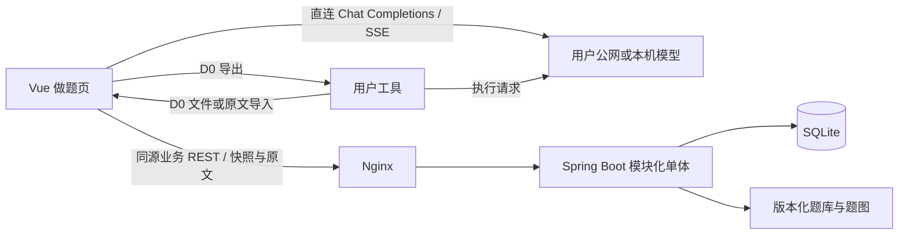
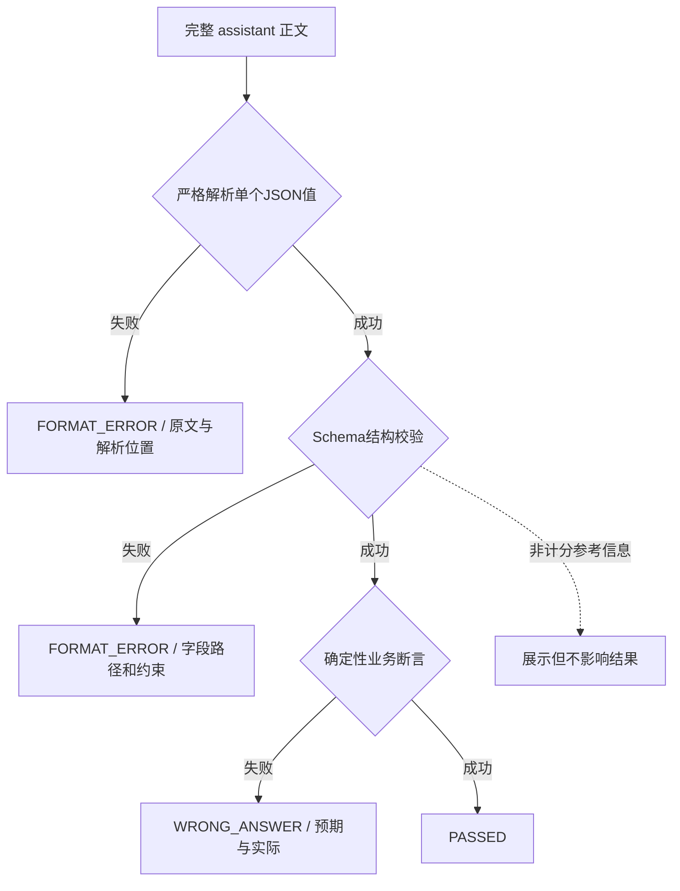

# Prompt Practice｜产品与技术方案

> v0.2 · 2026-11-25 · 开发前设计
>
> 部署预算：2 核 CPU / 2 GB RAM / 40 GB 系统盘。网关兼容性及具体依赖版本待验证。

## 目录

1. [产品定位与首版范围](#1-产品定位与首版范围)
2. [模型接入](#2-模型接入)
3. [架构、数据与部署](#3-架构数据与部署)
4. [三个主要页面与统一做题页交互](#4-三个主要页面与统一做题页交互)
5. [JSON 判题体系与三道样题](#5-json-判题体系与三道样题)
6. [实施顺序、验证与参考](#6-实施顺序验证与参考)
7. [待确认事项](#7-待确认事项)

# 1. 产品定位与首版范围

Prompt Practice 面向 Prompt 初学者和开发者，借鉴 LeetCode 的题目、编辑器、测试用例、反馈和练习记录布局。判定的是一次给定输入的正文是否满足规则。用户可以控制请求和结果，平台不要求证明模型输出来源，不建设响应签名、防作弊校验或可信排行榜。**账号权限与业务数据校验仍由服务端执行。**

| 范围 | MVP |
|---|---|
| 账户与题库 | 邮箱密码和登录会话。中英文、分类、难度、公开用例和版本化题库，由项目所有者人工维护 |
| 模型运行 | 用户自带模型、网关和可选 Key。浏览器直连为主，D0 手动运行兜底。首版取消平台预置模型及免费额度 |
| 判题 | Java 对完整原始正文做严格 JSON、Schema 和确定性断言。一次运行对应一个公开用例 |
| 学习记录 | 草稿、不可变运行快照、判题反馈和历史。用户可归档已完成判题的运行，归档不再调用模型 |
| 视觉题 | 保留样题和接口设计，进入公开题库前验证真实图文模型、请求体大小和 D0 导出链路 |

用户选题和样例、编辑 Prompt、预览消息，随后选择「直接运行」或「手动运行」。两条路径冻结同样的题目版本、样例、Prompt 和请求上下文，得到完整正文后提交同一 Java 判题 API。结果区展示原文与反馈，用户可立即修改下一版。切换方式保留题目、用例和草稿。三道样题用于框架验证，Claude 讲座原题由用户提供后再确定正式收录。

# 2. 模型接入

| 优先级 | 接入方式 | 定位 |
|---|---|---|
| P0 | 浏览器直连 | 首版主要运行方式 |
| P0 | D0 手动运行与结果导入 | 首版通用兼容方案，无需安装专用客户端 |
| P1 | 独立安全代理 | 解决公网模型接口的 CORS 兼容问题，默认不部署 |
| P2 | 本地客户端或浏览器扩展 | 本机网关自动化接入，按实际需求再评估 |

开发前用目标人群实际常用的网关验证直连。如果常用公网目标在合理配置后仍普遍无法直连，结合受影响用户比例与 D0 操作成本决定是否提前评审 P1。主要阻塞若来自本机网络访问，应优先维持 D0 并评估 P2，公网代理无法访问用户的 localhost。

## 2.1 浏览器直连

Vue 参考 Open WebUI Direct Connections，用 Fetch、AbortController 和成熟 SSE 解析库直接请求用户配置的 OpenAI Chat Completions 兼容接口。Java 不发起推理。连接设置支持 Base URL、可选 Key（无鉴权本地网关留空）、Model ID、获取模型列表和测试连接。Base URL 输入实际 API 前缀，按规则拼接 GET /models 或 POST /chat/completions，展示最终路径，不盲加 /v1。拒绝 URL 中的凭据、查询参数和片段。模型列表不可用仍可手填 ID，并用小型生成请求验证实际连通性。发送前提示测试可能消耗额度。

支持普通 JSON 和 SSE。前端逐步显示 assistant 正文，SSE 解码处理 UTF-8 跨块、多行事件和结束条件。首版收取第一条结果，普通响应与 SSE 均验证兼容协议的正常终止和非空正文。截断、内容过滤、未完成、工具调用、协议错误及用户取消均不提交判题。AbortController 用于停止读取和中止请求，上游是否停止计费须实测；同一次运行不自动重发。设定总时长、首包/流空闲和累计字节上限，超限立即取消；阈值通过联调确定。失败可展示已收到的部分正文，运行记录只提交必要、脱敏的故障代码。

轻量 ModelTransport 封装测试连接、查询列表、普通请求与流式请求。首版仅 DirectTransport，D0 独立完成导出和导入，两者输出统一的运行结果（runId、来源、状态、可选原始正文和结束原因、安全故障代码、时间与模型 ID）。后续可添加 ProxyTransport。题目加载、快照、消息拼装和结果展示复用，共用后端判题，暂不引入插件系统。

### 跨源与本地网络

- 目标接口必须允许真实网站 Origin，通常含协议、域名和端口。Authorization 与 application/json 通常触发 OPTIONS 预检，需要检查允许的方法、请求头、预检和实际响应。网站自身的前端或 Nginx 配置无法替目标放行 CORS。
- 本机网关还受 Mixed Content、Local Network Access、浏览器权限与版本影响。以同源 HTTPS 预览站在目标浏览器和操作系统实测。公网 HTTPS 为默认要求，本地 HTTP 首版建议仅对显式配置的 localhost 或 loopback 地址开放，并以浏览器实际许可为准。
- 优先确认目标网关能否限定网站 Origin。自动注入用户 Key 的本地代理若对任意网站开放，恶意页面可能消耗用户额度。兼容性不足时引导 D0，不建议开放通配 Origin、使用 no-cors、关闭浏览器安全功能或接入公共 CORS 代理。
- HTTP 状态可读时，按鉴权、路径/模型、限流、上游异常等分别提示。Fetch 拒绝时提示可能为 CORS、DNS、TLS、网络或本地网络权限，给出相应检查和手动运行入口，不武断归类为 CORS。

### 浏览器凭据与渲染安全

- API Key 默认只在 JavaScript 内存。用户主动开启后允许当前标签页用 sessionStorage 保留，退出、删除连接和主动清除时同时清理内存及会话副本。首版无 localStorage/IndexedDB 密钥存储或自研加密；内存和 sessionStorage 都无法彻底防御 XSS。
- 非敏感连接配置可在浏览器持久化，按站点账号隔离。Key 绑定规范化 Base URL，改地址时先停用旧 Key，须明确确认才可绑定新目标。Fetch 使用 redirect: 'error'、credentials: 'omit'，仅对明确选定的目标发 Authorization。提示仅接入可信服务。
- 直连 Key 只交给用户选择的模型服务，不进入平台 API、URL、日志、埋点、错误报告、运行记录和导出。运行/导出使用专门字段白名单，禁止序列化配置对象或请求头。用户自行粘贴的学习正文如含私人信息，应在提交前删除并重新导入合适内容。
- Prompt 和模型输出按不可信文本处理。Vue 默认转义，Markdown 可用 markdown-it 并关闭原始 HTML；确需输出不可信 HTML 时用 DOMPurify。限制链接协议并默认关闭外部图片等自动加载。原始输出与渲染视图分离，判题用原始正文。
- CSP 优先限制脚本、对象、嵌入、框架与资源来源，避免第三方统计/客服脚本和外部 JS CDN。固定站点 CSP 无法按页面内用户输入动态扩展。开发前比较固定来源名单和仅针对 connect-src 的 HTTPS 范围及受限 loopback 例外，验证实际浏览器的匹配行为；业务代码仍强制 URL 规则，不因自定义模型地址而整体放宽 CSP。

## 2.2 D0 手动运行

1. 编辑 Prompt、选择用例，冻结本次请求。
2. 复制 JSON 或下载 request.json，在已有模型工具中执行（例如 curl、Postman、Bruno 或本机网关支持的工具）。
3. 对照待导入卡片的题目、用例与 runId，导入响应 JSON，或粘贴完整的模型原始正文。
4. 浏览器读取并提取正文，提交统一判题。修改 Prompt 或更换用例后建立新运行。

D0 不要求网站知道 Base URL 或 API Key。每次只导出一个用例，下载名建议为 request-<caseId>-<runId>.json，复制时也显示关联信息；标准 API 响应不保证回传这些 ID，用户在导入位置确认对应关系，平台不做可信绑定证明。可在导出时填 Model ID 或本地替换占位值，导入时可确认实际使用的模型。冻结用于上下文与历史记录。导出没有凭据或认证头，使用兼容请求结构。

```json
{
  "model": "YOUR_MODEL",
  "messages": [
    {"role": "system", "content": "Reply using exactly three words."},
    {"role": "user", "content": "Describe the ocean."}
  ],
  "stream": false
}
```

该片段演示请求结构。正式题目仍使用各自的输出契约。

**响应导入**。浏览器先限制文件/粘贴长度，再本地读取 JSON，检查外壳、错误对象、choices、第一条 message 及 finish_reason。只接受正常结束且 choices[0].message.content 为非空字符串的响应。拒绝空白、错误返回、截断、工具调用和不支持的结束状态；不导入完整 HTTP 日志。粘贴方式由用户确认正文完整，提醒聊天客户端可能额外添加系统提示。两种方式都保留原文，不 trim、不去围栏、不修复 JSON、不改标点，仅将快照关联及判题所需数据提交平台。

### macOS / Linux Bash

在保存请求 JSON 的目录启动 Bash，核对文件名、替换 Model ID 和 Base URL。以下示例针对无鉴权网关，需鉴权时在提示处输入；使用 curl 7.76.0 或更新版本（--fail-with-body）。每次在当前目录创建独有的结果目录，只有 curl 成功且 HTTP 为 2xx 才生成 response.json。

```bash
(
  set +x
  set -o pipefail
  base='http://127.0.0.1:11434/v1'
  request='request.json'
  [[ -r "$request" ]] || { printf 'Request file missing\n' >&2; exit 1; }
  run_dir=$(mktemp -d ./promptlab-run.XXXXXXXX) || exit 1
  trap 'rm -f -- "$run_dir/body.tmp"' EXIT

  unset key
  IFS= read -r -s -p 'API Key (Enter for no auth): ' key || exit 1
  [[ $key != *$'\r'* ]] || { printf 'Invalid API Key characters\n' >&2; exit 1; }
  printf '\n'
  args=(--fail-with-body --silent --show-error --connect-timeout 5
        --max-time 180 --max-filesize 1048576
        -H 'Content-Type: application/json' --data-binary "@$request"
        -o "$run_dir/body.tmp" -w '%{http_code}')
  if [[ -n "$key" ]]; then
    status=$(printf 'Authorization: Bearer %s\n' "$key" |
      curl -q -H @- "${args[@]}" "${base%/}/chat/completions")
    code=$?
  else
    status=$(curl -q "${args[@]}" "${base%/}/chat/completions")
    code=$?
  fi
  unset key
  if [[ "$code" -ne 0 || "$status" != 2[0-9][0-9] ]]; then
    printf 'Request failed (curl %s, HTTP %s)\n' "$code" "$status" >&2
    exit 1
  fi
  mv -- "$run_dir/body.tmp" "$run_dir/response.json" || exit 1
  printf 'Import this file: %s/response.json\n' "$run_dir"
)
```

无鉴权时可直接回车，脚本只发 Content-Type 请求头。只用无鉴权网关时，可删除从 unset key 到 printf 换行的输入部分，再用以下两行替换 if/else 鉴权分支以及其后的 unset key。保留 args 数组和文件、HTTP 状态检查。

```bash
status=$(curl -q "${args[@]}" "${base%/}/chat/completions")
code=$?
```

### Windows PowerShell

在 PowerShell 中进入请求文件目录，替换文件名、Model ID 和 Base URL。使用 curl.exe 7.76.0 或更新版本，避免 PowerShell 的 curl 别名。用隐蔽输入读取 Key，通过 stdin 送入请求头；无鉴权直接回车。

```powershell
& {
    $base = 'http://127.0.0.1:11434/v1'
    $request = 'request.json'
    if (-not (Test-Path -LiteralPath $request -PathType Leaf)) {
        throw 'Request file missing'
    }
    $runDir = Join-Path (Get-Location).Path ('promptlab-run-' + [guid]::NewGuid())
    New-Item -ItemType Directory -Path $runDir -ErrorAction Stop | Out-Null
    $tempFile = Join-Path $runDir 'body.tmp'
    $response = Join-Path $runDir 'response.json'
    $curlArgs = @('--fail-with-body', '--silent', '--show-error',
                  '--connect-timeout', '5', '--max-time', '180',
                  '--max-filesize', '1048576', '-H', 'Content-Type: application/json',
                  '--data-binary', "@$request", '-o', $tempFile, '-w', '%{http_code}',
                  ($base.TrimEnd('/') + '/chat/completions'))
    $secret = Read-Host 'API Key (Enter for no auth)' -AsSecureString
    try {
        if ($secret.Length -eq 0) {
            $status = & curl.exe -q @curlArgs
        } else {
            $ptr = [Runtime.InteropServices.Marshal]::SecureStringToBSTR($secret)
            try {
                $key = [Runtime.InteropServices.Marshal]::PtrToStringBSTR($ptr)
                if ($key -notmatch '^[\x21-\x7E]+$') { throw 'Invalid API Key characters' }
                $status = "Authorization: Bearer $key" | & curl.exe -q -H '@-' @curlArgs
            } finally {
                Remove-Variable key -ErrorAction SilentlyContinue
                [Runtime.InteropServices.Marshal]::ZeroFreeBSTR($ptr)
            }
        }
        $code = $LASTEXITCODE
        if ($code -ne 0 -or $status -notmatch '^2[0-9][0-9]$') {
            throw "Request failed (curl $code, HTTP $status)"
        }
        Move-Item -LiteralPath $tempFile -Destination $response -ErrorAction Stop
        "Import this file: $response"
    } finally {
        if ($null -ne $secret) { $secret.Dispose() }
        if (Test-Path -LiteralPath $tempFile) { Remove-Item -LiteralPath $tempFile }
    }
}
```

只用无鉴权网关时，可直接将密钥读取和 try 内的鉴权分支改为调用 `$status = & curl.exe -q @curlArgs`，并删除 finally 中清理 `$secret` 的一行，保留状态检查及临时文件清理。两个示例都把 -q 放在首个参数位置，保持 TLS 校验，不跟随重定向。2xx 仍需经过网站的响应正文检查，只有本次打印的文件可导入。请求与响应可能含私人信息，按需清理，避免分享。curl 的大小限制随版本存在差异，浏览器导入仍独立执行字节上限。其他平台与工具需用第 6 节矩阵验证。 [curl 官方参数说明](https://curl.se/docs/manpage.html#--fail-with-body)

## 2.3 P1 独立安全代理

候选链路为 Vue → Spring Boot → OkHttp → Smokescreen → 公网模型 API。Smokescreen 是 HTTP CONNECT 出站代理候选。公开源码中的 safeResolve/dialContext 体现了解析地址校验和建连路径的关联，最终行为以锁定版本验证为准。Spring Boot 控制业务接口、鉴权、请求格式和限流；候选选型须经第 6 节验证。只有用户显式选择并授权时，平台才接收本次调用的 API Key；不持久化、不记录，直连失败时不得自动转交。该路径限公网 API。

正式设计需验证 SSRF 防护、DNS 重绑定防护、实际连接 IP 与校验结果一致、IPv4/IPv6 及特殊用途地址过滤、云元数据与服务器自身地址拦截、拒绝重定向、TLS 证书和主机名验证。使用 nftables、systemd 或已验证的 OS 级网络隔离防止应用直连绕过，代理不可用时默认拒绝。还需验证请求并发、速率、超时、响应大小、跨用户隔离、Key 脱敏、SSE 与取消传播。Smokescreen 的维护、安全策略、实际内存及隔离能力通过验证后才可定型。 [Smokescreen 源码](https://github.com/stripe/smokescreen/blob/master/pkg/smokescreen/smokescreen.go) · [OWASP SSRF 指南](https://cheatsheetseries.owasp.org/cheatsheets/Server_Side_Request_Forgery_Prevention_Cheat_Sheet.html)

# 3. 架构、数据与部署

## 3.1 分工与数据流



Vue 管理连接、凭据、请求预览、模型传输、导入导出与运行状态。Java 管理认证、题库、草稿、权限、运行记录和判题，依据冻结的题目版本及样例加载规则。后端按题库和允许编辑的 slots 规范化快照，不验证第三方是否执行了该请求。题目/样例/版本/账号等属于业务校验，模型来源、Model ID、结束原因等是用户侧提供的学习记录。

## 3.2 技术与模块

| 领域 | 首版设计 |
|---|---|
| 后端 | Java 21 LTS、Spring Boot + Spring MVC、Maven Wrapper、cn.shiinapple 包前缀 |
| 前端 | Vue 3、TypeScript、Vite，路由与中英 i18n，Fetch、AbortController、成熟 SSE 解析库，本地文件解析 |
| 数据 | SQLite 单机。验证 JDBC、迁移、WAL、事务、忙等待和备份恢复。Jackson 严格解析，Schema 库验证后锁定版本 |
| 安全 | Spring Security、同源会话、CSRF、XSS/CSP、登录限速和账号隔离 |
| 部署 | Nginx 静态 dist 与 /api 同源转发，systemd 运行 Java jar |
| 推迟 | OkHttp、okhttp-sse、SseEmitter 模型转发、模型请求线程池与出站隔离随 P1 评审。凭据加密存储无首版需求 |

后端按 auth、problem、practice、judge、settings、common 模块划分；前端连接设置与 practice 运行逻辑独立。首版不部署模型网关、Redis、消息队列、独立 Node 服务或其他分布式组件。确切版本和依赖以联调和维护状态为准。

## 3.3 概念数据模型

| 实体 | 主要字段及约束 |
|---|---|
| users / user_settings | 邮箱唯一、passwordHash、可选 verifiedAt、账号状态、语言和编辑偏好 |
| problem_versions | problemId/version、内容哈希、发布时间。旧版本和受信资产不可覆盖 |
| drafts | userId/problemId/version、editableSlots、selectedCaseId、revision、updatedAt |
| prompt_snapshots | userId、problemId/version、caseId、slots、规范化 messages 或可重建引用、requestParams、createdAt。题图用版本化资产引用，避免重复写入 base64 |
| runs | userId、snapshotId、来源 DIRECT/D0、声明或客户端报告的 modelId、idempotencyKey、运行状态、可选原始完整正文、结束原因、故障码、verdict/checks、createdAt/finishedAt |
| submissions | userId、runId、submittedAt，同一次运行归档幂等 |
| email_verification / reset_tokens | 需要邮件能力时使用，存 token 哈希、用途、有效期和使用时间 |

连接配置留在浏览器。数据库不存 Base URL、API Key、connectionId、加密字段、可信等级、免费配额或预留结算数据。未完成记录以过期状态收敛，终态只由首次有效提交设置，用户可重新运行。所有查询按用户授权，保留期和账户删除策略见第 7 节。

## 3.4 API 与运行时序

| 方法与路径 | 用途 |
|---|---|
| POST /api/auth/register、/login、/logout | 注册、登录、退出，可按邮件方案接入验证与重置 |
| GET /api/me；GET/PATCH /api/settings | 账号和非敏感偏好 |
| GET /api/problems；GET /api/problems/{id} | 题库、题目版本、编辑槽与公开样例 |
| GET/PUT /api/problems/{id}/draft | 草稿，revision 防覆盖 |
| POST /api/runs | 校验题目版本、用例、slots、模式，返回 runId 和规范化快照，按用户及幂等键去重 |
| POST /api/runs/{id}/result | 提交完整原文与必要的模型元数据判题，或提交取消/故障状态及脱敏代码 |
| GET /api/runs/{id}；GET /api/problems/{id}/runs | 本人运行详情和题目历史 |
| POST /api/submissions；GET /api/submissions | 归档已判题的运行、查看归档 |

创建快照后浏览器按快照组装 payload，执行直连或 D0 导出。直连取消在浏览器完成，必要时上报状态。D0 文件处理、模型列表和连接测试也由浏览器完成，无服务器模型连接 CRUD、模型事件订阅、上游取消与文件上传端点。结果事务原子写入，重复提交同一结果返回既有结果，改交另一份正文须新建运行。页面断线重连可查询已有结果，正在运行的浏览器流不能跨刷新续接；不得静默重发推理。服务端拒绝越权、未知字段、不合法输入、超大正文和非法状态变更；错误返回 code、messageKey、安全 details、requestId。

## 3.5 账户、资源与部署

同源 Cookie 使用 Secure、HttpOnly、SameSite=Lax，修改请求启用 CSRF。使用 Spring Security PasswordEncoder、登录限速、会话轮换与合理 TTL。邮箱规范化避免擅自删除加号或点号。公开注册的验证和找回依赖邮件服务，邀请内测可采用预建账号。日志只记录必要的业务元数据，严禁记录凭据和完整请求体，不开启生产调试端点。

2 核 2 GB 环境中，将 SQLite、Java 和 Nginx 部署在同一主机，静态资源在构建环境产出。通过模拟用户请求测试 JVM RSS、CPU、事务并发、磁盘增长和备份恢复；限制 API 请求体及判题负载，配置日志轮转。备份使用 SQLite 一致性备份方式并做恢复演练。运行途中重启允许客户端查询快照和提交待判正文，过期运行可从草稿重新建立。没有平台模型 SSE 路径，无需专门配置 Nginx 的模型流式转发。具体 JVM 配额、正文大小、历史留存期按同规格验证结果确定。

原稿提及 Vue + Spring Boot 待办项目和 code/frontend/src/color-tokens.css。当前工作区未提供这些源码。开发前只读核对依赖、认证、部署配置及真实 Design Token，经确认再复用通用配置和组件。建议 frontend/、backend/、content/、deploy/、docs/，后端业务包按模块组织。

# 4. 三个主要页面与统一做题页交互

## 4.1 全站导航与视觉原则

桌面优先，手机端允许纵向布局。顶栏：站点名称 / 题库 / 练习记录 / 模型设置 / 语言（中文、English）/ 账号；状态标签统一使用文字与图标，不能只靠颜色。布局、间距、背景、文字、边框、主按钮、成功/失败、圆角和焦点样式优先从现有 Design Token 映射。未读取 CSS 前不杜撰现有变量名称或颜色值；先建立语义需求清单（surface、text、border、accent、success、danger、focus），复用实际 token 或薄映射层，不另外建一套主题系统。

UI 文案采用 Vue I18n key；错误返回稳定 code/messageKey，规则有中英文标签；JSON 字段名、模型 ID、API 路径和 run ID 不翻译。题目中文/英文 Markdown 分开，Prompt 模板及测试输入按题目配置决定是否共享或本地化。切换语言不覆盖已编辑 Prompt；若样例内容随语言变化，则作为明确 caseId/locale 绑定运行快照，而非悄悄换输入。优先首屏简洁，不显示无关参数与复杂 dashboard。

## 4.2 题库页

```text
┌ Prompt Practice ── 题库 ── 练习记录 ── 模型设置 ── 中文/EN ── 账号 ┐
│ 题库 / Problems                                                       │
│ [搜索题目________________] [分类: 全部 ▾] [难度 ▾] [练习状态 ▾]           │
│ --------------------------------------------------------------------- │
│ 状态    题号 / 题目名称                      分类           难度          │
│ 未练习  001 月港酒馆的守夜人                  角色扮演       入门          │
│ 已通过  002 从需求生成测试用例                开发           入门          │
│ 未练习  003 票据字段提取                      Agent/业务     基础 · 图片   │
│ --------------------------------------------------------------------- │
│ 状态解释：未运行 / 已运行 / 有通过记录；点题目进入，不自动调用模型。       │
└───────────────────────────────────────────────────────────────────────┘
```

初次用户可以不配置模型浏览题目；点击运行才要求登录/连接。图片题显式能力标签。列表的「已通过」依据本站有通过的练习运行或归档（建议以已提交通过为准，待确认），外部结果标注来源而不混作认证成绩。首版可静态分页，题库规模小不需要全文检索引擎。提供加载、空结果、失败重试状态，搜索本地化标题和标签。

## 4.3 做题页线框（桌面）

```text
┌ 题库 / 002 需求转测试用例                 [模型: 我的连接 ▾] [直接 / 手动 ▾] ┐
│                                            [连接设置] [中文/EN]             │
├─────────────────────────┬─────────────────────────────────────────────┤
│ 题目说明 / Description   │ Prompt                 [草稿已保存] [历史]   │
│ 任务目标、输出契约         │ [System（仅题目配置时出现） ▾]                 │
│                           │ ┌─────────────────────────────────────────┐ │
│ 示例输入 Case 1 ▾         │ │ 可编辑 Prompt                            │ │
│ 需求：长度 6–12……         │ │ 将以下需求转换为测试用例……                │ │
│ [只读输入]                │ │ {{requirement}}                           │ │
│                           │ └─────────────────────────────────────────┘ │
│ 输出 JSON 结构            │ [重置模板] [请求预览 ▾] [复制/下载请求]       │
│ 示例 / 自动判定规则       │                 [运行测试] [提交练习]        │
│                           ├─────────────────────────────────────────────┤
│ 图片 / 历史消息（按需）    │ 测试结果  [原始输出] [判定详情] [请求信息]    │
│                           │ Case 1  · 当前模型 · 运行中  [停止]          │
│                           │ { "cases": [ ...                            │
│                           │ 状态区 / 失败字段、预期和实际值               │
└─────────────────────────┴─────────────────────────────────────────────┘
```

模型选择器在做题页头部固定位置，跨题保留当前选择，但用户可设置默认连接。下拉展示浏览器中保存的模型连接、能力和连接状态；运行方式单独选择；按钮「管理连接」打开设置，返回原题恢复草稿。首版不做多模型并行。运行期间模型选择可以禁用或允许选择下一次配置，当前 run 的模型不受影响；明确显示「本次运行使用…」。窄屏题目说明折叠为可访问的标签/区域，模型选择仍在编辑器顶部。

编辑器默认单栏自然语言 textarea；仅题目需要多段时展示角色、系统、用户、历史消息等配置。行号、代码高亮并非必需。底部结果区默认打开原始输出，完成后同时显示判定总览与规则详情入口；不要在失败后把原始输出隐藏。请求预览折叠，用户随时打开查看发送内容和只读字段来源。

## 4.4 题目如何驱动编辑区与消息组装

统一页面不是针对三种题写三个组件，而是由题目描述驱动。示意配置（字段名称待确认）：

```yaml
id: dev-testcases
version: 1
category: development
level: beginner
locales:
  zh: { title: 需求转测试用例, descriptionFile: zh.md }
  en: { title: Requirements to test cases, descriptionFile: en.md }
requiredCapabilities: [text]
variables:
  requirement: { type: text, required: true, source: testcase, editable: false }
slots:
  - id: instruction
    labelKey: prompt.instruction
    defaultText: '根据以下需求生成测试用例。{{requirement}}'
    editable: true
    requiredVariables: [requirement]
messages:
  - role: user
    parts:
      - type: editableSlot
        slot: instruction
cases:
  - id: case-1
    variables:
      requirement: '密码长度必须为 6 至 12，包含边界；仅检查长度，不检查字符种类。请覆盖边界前、边界及边界后：5、6、7、11、12、13。'
    schemaRef: schema.json
    rulesRef: rules.json
modelParams: { maxOutputTokens: 1024 }
```

字段策略：

| 内容 | 固定/可编辑 | 默认展示 |
|---|---|---|
| 题目描述、输出契约、测试输入、规则 | 题目固定 | 展开，测试输入只读 |
| System Prompt | 由题目指定 fixed 或 editable slot | 有且可编辑时显示；固定或高级信息可折叠但可见 |
| User Prompt | 可编辑 slot 或题目固定消息 | 普通题唯一编辑区，默认展开 |
| 模板变量 | 定义和样例值由题目固定；编辑区可引用变量 | 变量 chips / 插入按钮，显示缺失和未知错误 |
| 图片 | 题图由样例 assetId 指定，不默认允许换图 | 仅视觉题显示缩略图与放大；图片能力校验 |
| 多轮对话 | 题目定义固定历史角色、顺序、内容或指定可编辑 slot | 历史默认折叠，可查看；当前用户消息默认展开 |
| 模型参数 | 首版题目/连接受控默认值；可调项后置 | 请求预览中可见，不默默设置强制 JSON 模式 |

变量不是 JS 模板执行环境。仅支持确定性简单占位符 `{{name}}`，按明确白名单替换，不支持 `eval`、循环、任意表达式、远程读取；替换一次，不递归解释输入中出现的占位符。支持字面花括号转义约定，未知变量和缺失 requiredVariables 阻止运行；允许 JSON 示例的普通花括号。变量是题目的输入，若允许用户自由删掉输入会变成另一种练习，首版要求固定输入必须进入请求：可选择固定消息独立附加（固定消息方案），或要求编辑 slot 包含指定占位符。变量替换后仍作为字符串由 JSON serializer 编码，防止引号/换行破坏外层请求结构。

为保持预览、冻结快照和实际请求一致，定义统一规范化消息数据结构和组装规范（不是共享一套执行语言代码）。Vue 端用纯函数 `assembleMessages(problemVersion, slots, caseData)` 生成 `assembledMessages`，作为 computed 衍生状态，不存两套独立可编辑数据。编辑或选择 case 时自动更新；输入校验失败显示原因，不可运行。Java 端根据同一题库版本、caseId、允许编辑的 slots 重新组装并校验；运行回执提供规范化快照，Vue 用该快照执行直连或生成导出文件。共用一组 JSON golden fixtures（中英文、特殊字符、变量缺失、图片、固定多轮）测试两端输出一致；如需 hash，明确规范化序列化规则或只比较结构，不依赖对象键顺序。

### 具体预览例子

编辑区：

```text
你是测试工程师。根据需求：{{requirement}}
只输出一个 JSON 对象，cases 为测试用例数组。
```

固定样例变量：`requirement = 密码长度必须为 6 至 12，包含边界；仅检查长度，不检查字符种类。请覆盖边界前、边界及边界后：5、6、7、11、12、13。`

组装后的 messages 预览：

```json
[
  {
    "role": "user",
    "content": "你是测试工程师。根据需求：密码长度必须为 6 至 12，包含边界；仅检查长度，不检查字符种类。请覆盖边界前、边界及边界后：5、6、7、11、12、13。\n只输出一个 JSON 对象，cases 为测试用例数组。"
  }
]
```

实际首版 Chat Completions 请求结构：

```json
{
  "model": "<用户连接指定的模型 ID>",
  "messages": [
    {"role": "user", "content": "你是测试工程师。根据需求：密码长度必须为 6 至 12，包含边界；仅检查长度，不检查字符种类。请覆盖边界前、边界及边界后：5、6、7、11、12、13。\n只输出一个 JSON 对象，cases 为测试用例数组。"}
  ],
  "stream": true,
  "max_tokens": 1024
}
```

模型适配器按已验证能力处理参数；不支持参数时报告或明确按兼容规则省略，不悄悄改题意。预览不含 Key、内部平台地址或私有认证头；图片显示 assetId 和缩略图，实际发送为 `image_url` data URL（只允许平台受信 MIME、大小和内容），必要时可查看结构但默认不展开长 base64。模板变化时展示最新预览，历史运行页展示当时冻结的预览。D0 导出为 `stream:false` 并清晰标明与在线执行的传输差异，不改变 Prompt 或样例。对于将来协议适配器，明确区分规范化 messages 预览与厂商实际 payload 预览。

## 4.5 做题页状态、草稿与版本历史

| 情形 | 页面操作与持久化 |
|---|---|
| 未登录 | 可读题；运行/提交时引导登录并保留当前草稿（未登录草稿可仅存在本地，禁止保存秘密） |
| 未配置模型 | 显示「配置模型 / 手动运行」，可继续编辑 |
| 图片能力未知/不支持 | 未知时提示验证或明确继续试一次；明确不支持时阻止该模型运行图片题 |
| 运行中 | 输出区逐步追加正文，显示进度、计时、停止；冻结本次快照；禁止重复触发；可继续编辑下一版但标明与运行版本不同 |
| 调用失败 | 顶部状态+具体错误，保留已显示片段；失败不触发判题；提供编辑连接、切换模型或手动重试 |
| JSON/答案错误 | 原始输出保持；格式错误给位置/结构错误；答案错误给字段路径和规则 |
| D0 手动运行 | 显示当前题目、用例和运行 ID，提供复制 JSON、下载请求、粘贴和导入按钮；未导入时等待 |
| 切换题目 | debounce 保存草稿（建议 500–800ms），路由离开尝试立即保存；保存失败保留内存并提示，不静默丢失；可选择继续等待/留在当前页/明确放弃。运行不会被改成新题 |
| 刷新/断网 | 读取本地未同步草稿与服务器 revision；冲突提示选择版本，不能静默覆盖另一设备；按 runId 查询平台状态；刷新会结束浏览器内进行中的直连，提示新建运行 |
| 重置模板 | 确认后只重置当前草稿，旧 run 快照和提交保留 |
| 提交练习 | 选择最近完成且对应快照的运行；显示归档状态，不额外调用模型；导入来源单独标注 |

草稿是可覆盖状态，不等于运行历史。每次点击运行且服务器接受请求后保存不可变 snapshot（即使预检或上游失败，也可记录对应快照和拒绝/失败原因）；系统拒绝不合法输入时保留草稿即可。版本历史入口固定在编辑器标题旁，展示时间、模型、样例、通过/失败/故障、运行 ID；点击只读查看，可选择「复制到当前草稿」，不改历史；diff 可后置。历史条目可区分未提交的测试与正式归档。

练习记录页主要用于用户查看自己历史提交的 Prompt：时间、题目、版本、模型、用例、来源、结果，点击展示当时 Prompt、原始回复与规则反馈；默认不展示秘密或连接地址。不把它设计为排行榜。未提交运行可由单题历史进入；已提交记录的保存政策与账户删除策略待确认。

## 4.6 模型连接设置页

显示浏览器中保存的连接、Model ID、最后一次客户端测试及可选视觉能力。连接详情提供名称、Base URL、最终路径、API Key（可空且默认仅在内存）、标签页会话保留开关、模型列表或手填、测试连接、清除凭据和删除配置。测试可报告状态、延迟与错误类别，保留原始草稿并提供返回题目和手动运行入口。D0 无需创建模型连接。连接设置、失败提示、隐私说明和手动运行文案均提供中英文。

# 5. JSON 判题体系与三道样题

## 5.1 统一判题契约

所有题目必须能以明确 JSON 契约判题。不要求 JSON 文本的缩进、字段顺序、Unicode 转义写法相同，但必须整段是一个合法 JSON 值（每道样题根类型为 object）。允许标准 JSON 首尾空白；拒绝 Markdown 围栏、解释前缀/后缀、多段 JSON、尾随逗号、注释、非标准数值和重复对象键。不要用正则从一段回答中提取第一个 `{...}`，不要自动 trim 掉非 JSON 内容或修复语法。先由适配器提取最终 assistant 正文，不把上游响应外壳本身当作答案。浏览器只在正常结束后提交正文判题。手动粘贴由用户声明正文完整，记录 D0 来源。



解析建议：Jackson 启用重复键检测与 trailing tokens 检查，关闭 lenient JSON 选项，配置输入长度、嵌套深度、字符串与数值长度上限。JSON Schema 固定一个明确 draft（推荐 2020-12，库版本须验证）；只加载本地受信题目资源，不允许 validator 远程获取 `$ref`。Schema 管结构、类型、必填、枚举、数值范围；业务断言管与具体样例对应的答案。根对象附加字段是否允许由每题明确配置。不要默认类型强制转换：字符串 `"true"` 不等于布尔 `true`，金额字符串和数字按题目声明区分。

断言 DSL 只支持明确枚举的操作，例如 `equals`、`exists`、`nonBlank`、`arraySize`、`setEquals`、`uniqueBy`、`each`、`range`、`mapEquals`（使用受限 JSON Pointer，数组规则在 Java 中实现），不允许用户或远程题库执行任意 JavaScript/Python/SpEL/SQL。数值比较用 BigDecimal，字符串默认精确（如要 trim/大小写不敏感必须题目显式声明）；数组排序是否敏感由题目规定。规则由题目版本固定，业务规则不能由前端参数覆盖。首版不需要复杂的 JSONPath 脚本表达式；成熟库处理格式，少量自研白名单业务规则。

反馈结构示例：

```json
{
  "transportStatus": "COMPLETED",
  "verdict": "WRONG_ANSWER",
  "checks": [
    {"id": "json", "status": "PASS"},
    {"id": "schema", "status": "PASS"},
    {"id": "boundary-5", "path": "/cases", "status": "FAIL",
     "expected": {"length": 5, "expectedValid": false},
     "actual": {"length": 5, "expectedValid": true}}
  ]
}
```

规则失败要显示可操作的具体信息；通过的字段可以收起，未通过规则展开。显示完整模型原始回复并提供复制，格式化视图仅对解析成功正文作为额外展示，不代替原文。任何 `referenceOnly` 字段均不阻止通过，必须明确标为未自动评价。

模型波动：同一 Prompt 和输入可能因模型版本、采样、网关路由、上下文或推理差异得到不同结果。平台只判定本次运行，记录客户端报告或用户声明的模型 ID、题目版本、用例、参数和来源；没有跨模型统一准确率承诺。若网关支持，可将 temperature 设置为较低且公开的默认值，但不能保证确定性，也不能在模型不支持时暗中替换；题库不依赖模型专有约束生成。默认公开样例，不做隐藏测试，不把多次通过合成 Prompt 泛化认证。一次运行处理一个公开用例。多个用例分别执行，明确每次调用可能消耗用户额度。

## 5.2 样题 001：月港酒馆的守夜人 / The Night Watcher of Moon Harbor

**分类：** 酒馆/角色扮演；难度入门；能力 text。  
**题目目标：** 编写角色 Prompt，使模型以酒馆守夜人「艾琳 / Eileen」的身份回应旅人的问题，并返回约定的 JSON 对象。人设表现是练习目的，不是自动判定能充分验证的事实。

题目人设（固定说明）：艾琳在月港经营一家深夜酒馆，外表冷淡、说话克制，但愿意为迷路的旅人提供帮助；不知道的事情不编造。英文题目说明提供同等要求；此样例角色输出语言可由用户选择，`name` 不强制等于特定语言写法。

**初始模板与编辑规则：**

| 消息 | 初始内容 | 可编辑性 |
|---|---|---|
| system | `你是艾琳，月港酒馆的守夜人。请以角色身份回答旅人的问题。` | 用户编辑（主编辑区） |
| user | `{{question}}` | 题目固定，不可修改 |
| 历史消息 | 无 | 不显示 |

Case 1 固定输入：`外面下了很大的雨，我可以在这里待到天亮吗？`  
英文变体可作为独立公开 case：`It's pouring outside. May I stay here until dawn?`

用户需要自行在 system Prompt 中加入输出契约、语气要求等，不由平台偷偷追加。例如改为「你是艾琳……只输出一个 JSON 对象，name 和 reply 为非空字符串；可以给出自评 in_character」。

**预期结果示例（非唯一正确文本）：**

```json
{
  "name": "艾琳",
  "reply": "门没锁。去炉火旁坐着吧，等雨停了再走。",
  "in_character": true
}
```

**Schema（设计示例）：**

```json
{
  "type": "object",
  "required": ["name", "reply"],
  "properties": {
    "name": {"type": "string", "minLength": 1},
    "reply": {"type": "string", "minLength": 1},
    "in_character": {}
  },
  "additionalProperties": false
}
```

自动判定规则：整段 JSON 对象合法；`name`、`reply` 必须为非空、非纯空白字符串；`in_character` 是可选参考字段，不验证其真伪、布尔类型或是否存在（展示时可说明建议填写布尔值）；额外未知字段违反此题明确约定。`name` 不做与「艾琳」字面相等的答案检查，`reply` 不对人设、语义或内容质量打分。通过文案必须是「JSON 格式通过；人设表现未自动评价」，不是「角色扮演正确」。`{"name":"艾琳","reply":"...","in_character":false}` 也可通过结构判定。

**页面操作路径：** 左侧先看到人设、固定旅人问题和字段说明；右侧只展示一个可编辑 system 区，固定 user 消息显示为只读或折叠预览。选择模型，点击运行测试，下方看原始回复及两个格式字段的检查；参考字段单独展示。修改 system Prompt 后重跑，确认喜欢的版本再提交。后续多轮角色题可在同一 messages 配置内增加固定 user/assistant 历史，不需要新页面。

失败示例：模型回复 `好的，你可以留下。` → JSON 格式错误；`{"name":"艾琳"}` → 缺少 `/reply`；`{"name":"艾琳","reply":123}` → `/reply` 类型错误；缺少 `in_character` 不影响结果。

## 5.3 样题 002：需求转测试用例 / Requirements to Test Cases

**分类：** 开发 Prompt；难度入门；能力 text。  
**题目目标：** 把自然语言需求转成固定 JSON 结构的边界测试用例，不依赖代码运行。为了可确定性判题，明确测试覆盖要求和判定标准。

**固定测试输入 Case 1：** `密码长度必须为 6 至 12，包含边界；仅检查长度，不检查字符种类。请覆盖边界前、边界及边界后：5、6、7、11、12、13。` 英文版为等价需求，必要时使用独立 caseId。输出固定为 `cases` 数组；每条包含整数 `length` 和布尔 `expectedValid`；每个指定长度恰好出现一次，不要求数组顺序。测试数据长度本身作为抽象输入，不要求模型生成真实密码字符串。

**初始模板（用户可编辑的单一 user slot）：**

```text
根据以下需求，生成测试用例：
{{requirement}}
```

`requirement` 由样例固定注入，必须保留占位符；允许用户编辑其周围全部指令。用户可自行加入「只返回 JSON 对象；cases 为数组；每项包含…」等具体约束。系统消息无，历史无。

**预期结果（顺序可变）：**

```json
{
  "cases": [
    {"length": 5, "expectedValid": false},
    {"length": 6, "expectedValid": true},
    {"length": 7, "expectedValid": true},
    {"length": 11, "expectedValid": true},
    {"length": 12, "expectedValid": true},
    {"length": 13, "expectedValid": false}
  ]
}
```

**Schema（设计示例）：**

```json
{
  "type": "object",
  "required": ["cases"],
  "additionalProperties": false,
  "properties": {
    "cases": {
      "type": "array",
      "items": {
        "type": "object",
        "required": ["length", "expectedValid"],
        "additionalProperties": false,
        "properties": {
          "length": {"type": "integer"},
          "expectedValid": {"type": "boolean"}
        }
      }
    }
  }
}
```

业务规则：数组恰好 6 项；按 length 唯一，长度集合精确等于 `{5,6,7,11,12,13}`；对每项检查 `expectedValid == (6 <= length <= 12)`。允许顺序变化，但重复长度、缺少边界、附加未知长度或任何布尔值错误均不通过。另一个公开 Case 2 可把规则改为 3 至 8（包含边界），要求 2、3、4、7、8、9，预期分别 false、true、true、true、true、false；由题目配置分别绑定变量与断言。题库不把 Case 2 自动提交给模型。

**反馈示例：** 如果返回 `length: 5, expectedValid: true`，显示「长度 5 应为 false，实际为 true」；若缺少长度 13，显示「缺少必需边界用例 13」；若 `expectedValid` 为字符串，显示 Schema 类型错误。输出是含 Markdown 代码围栏的完整正文时直接格式错误。全部强制规则正确才通过。

**页面操作路径：** 左侧看需求和六个边界值、固定字段说明；右侧只有一个 Prompt 编辑区，变量 chip 表示 `requirement`，请求预览确认变量已被真实替换；运行测试，在下方查看原文和逐边界检查。切换 Case 2 时保留同一 Prompt 草稿，但运行创建新快照和新 caseId。结果与对应样例绑定，不能把 Case 1 的通过显示成 Case 2 的通过。

## 5.4 样题 003：票据字段提取 / Receipt Field Extraction

**分类：** Agent/业务任务；难度基础；能力 text + image。首版定位为视觉结构化提取，并非已具备实际业务工具调用的 Agent。

**题目目标：** 根据指定票据图片提取商户名称、票据编号、日期、含税总金额和币种，返回严格 JSON。避免从 Prompt 或辅助说明直接泄露整张票据文本；图片是事实来源。

**固定样例资产规范（待正式制图，并非真实票据扫描件）：** 由出题者制作一张清晰、虚构、无个人信息的 PNG/JPEG，文件 `receipt-001-v1.png`。图上应清晰印有如下内容（这是出题和验收说明，正式用户页面仅展示图片和字段要求，不将此文本作为隐藏模型输入）。可保留预期示例用于教学，若想让模型真正从图提取，不要把答案放入发送的 messages。

```text
        MOON HARBOR CAFE
        月港咖啡
        收据 / RECEIPT
编号 / No.          MH-20261125-001
日期 / Date         2026-11-25
拿铁 / Latte                 28.00
蛋糕 / Cake                  40.50
实付合计 / TOTAL         CNY 68.50
```

字段约定：`merchant` 取英文商户名（大小写按票面）；`receiptNo` 保留原编号；`date` 格式 YYYY-MM-DD；`total` 是两位小数的字符串（不含货币符号）；`currency` 为三字母 ISO 货币代码。金额用字符串是本题显式决定，避免 JSON 数字 68.5 与 68.50 在序列化后丢失显示精度。不要猜缺失字段；此样例所有必需信息均清楚显示。

**初始模板与编辑区：** 一个可编辑 user slot：`请读取图片中的票据并提取所需字段。` 固定消息由题目组装：同一个 user message 的 text part 来自编辑区，image part 来自样例 assetId；用户不能删除或替换图片。高级题可开放用户上传图片作为不计入正式用例的练习模式，但用户上传任意票据没有已知预期答案，首版不做自动判定该类开放输入。

**预期输出：**

```json
{
  "merchant": "MOON HARBOR CAFE",
  "receiptNo": "MH-20261125-001",
  "date": "2026-11-25",
  "total": "68.50",
  "currency": "CNY"
}
```

**Schema（设计示例）：**

```json
{
  "type": "object",
  "required": ["merchant", "receiptNo", "date", "total", "currency"],
  "additionalProperties": false,
  "properties": {
    "merchant": {"type": "string", "minLength": 1},
    "receiptNo": {"type": "string", "minLength": 1},
    "date": {"type": "string", "pattern": "^[0-9]{4}-[0-9]{2}-[0-9]{2}$"},
    "total": {"type": "string", "pattern": "^[0-9]+\\.[0-9]{2}$"},
    "currency": {"type": "string", "pattern": "^[A-Z]{3}$"}
  }
}
```

判定规则：结构和类型正确后按样例预期逐字段精确比较；日期还可由严格 LocalDate 解析验证有效日历日期，货币限定为本例 CNY。`"68.5"` 为格式错误，`"68.00"` 为答案错误；只输出拿铁单价 28.00 则提示合计字段实际值与预期差异；日期与票面不符时指出 `/date`。允许字段顺序变化，不进行 OCR 容错或擅自归一化商户名，若未来想接受别名应由题目定义。题目编辑器允许用户明确格式和选择英文商户名，不帮用户生成答案。

**实际 Chat Completions 消息结构（图片内容为示意占位符，非可调用 payload）：**

```json
[
  {"role": "user", "content": [
    {"type": "text", "text": "请读取票据，按字段要求仅输出JSON。"},
    {"type": "image_url", "image_url": {"url": "data:image/png;base64,<由受信题图生成>"}}
  ]}
]
```

**页面操作路径：** 左侧先看到票据缩略图（可放大）和字段约束；右侧编辑一个用户 Prompt；顶部模型选择器显示视觉能力。当前连接若明确不支持图片，提示切换视觉模型或使用能够接收图片的外部工具；能力未知时提醒先验证。点击运行，结果区先流式显示正文，正常完成后列出五个字段的规则结果。D0 导出可包含图片 data URL 或由本地资产生成完整 request JSON，手动聊天工具则由用户单独下载/上传同一张图。

### 视觉提取与真实 Agent 的边界

| 能力 | 仅视觉结构化提取（验证通过后发布） | 实际工具调用（后续） |
|---|---|---|
| 模型要求 | 接口支持图片 content parts 和文本输出 | 支持 tool/function calling 或相应 Agent 协议；若还要图则同时支持视觉 |
| 平台要求 | 图片资产加载、大小校验、普通模型调用、JSON 判题 | 工具声明与参数 Schema、tool_call 解析、白名单分发、工具结果回填、循环上限、超时、权限与审计 |
| 业务执行 | 无；只提取 JSON | 例如查询虚拟账本、创建报销草稿；首选沙箱/确定性 mock，真实写操作须单独授权和确认 |
| 评价证据 | 完整正文与固定票面事实 | 最终 JSON 之外，还应验证服务端观察到的调用轨迹、参数和模拟状态，不能信任模型自报「已完成」 |

首版不让模型读取真实财务系统、执行付款、访问任意 MCP Server 或执行用户提供的代码。后续先做固定只读工具或 mock 业务工具，再考虑真实连接器和有副作用的操作。样题保留 Agent/业务分类是业务语境，不宣称模型已执行报销流程。

## 5.5 题库维护与验收样例

题目作者新增题目时提交版本化配置、zh/en 描述、默认 slot、固定消息、公开 case 变量/题图、Schema、规则及至少一个应通过和若干应失败的输出 fixture。启动或 CI 进行 lint：ID 唯一、版本不可覆盖、翻译文件存在、变量可解析、固定角色顺序合法、图片存在且符合限制、规则类型和路径有效、预期答案通过自身 Schema、参考字段不计分。禁止 YAML 任意类型反序列化、远程 Schema 和动态脚本。旧版本题目继续可用于查看历史；新运行默认最新发布版本，草稿若版本不一致提示迁移/复制而非覆盖。

用户后续提供 Claude 讲座原题后，先用同一规范描述其输入、可编辑 Prompt、判定范围，检查是否能无需新增专用页面和任意代码判题完成。如果无法确定性判题，明确属于不适合首版的题，而非强行引入 AI 评审。题目正式收录、版权和翻译由项目所有者确认；这里的三道题仅供方案演示。

# 6. 实施顺序、验证与参考

## 6.1 从验证到实施

1. 开发前完成下表验证，记录实际证据，再确认首版接入是否需调整。
2. 实现题库、严格判题和样例 fixture，再接同源账户、草稿和统一做题页。
3. 接入浏览器直连和 D0，共同验收运行、判题、归档，并在目标规格主机试运行。
4. 按实际阻塞评估 P1 公网代理、P2 本地客户端或扩展。原生多协议、重型编辑器、Agent 工具和多实例部署按后续需要决定。

| 开发前最小验证 | 操作与通过标准 |
|---|---|
| 网关和浏览器 | 从真实 HTTPS Origin 验证 CC Switch、Magpie、Ollama、至少一个目标用户常用公网兼容网关和一个官方 Chat Completions API。覆盖目标 macOS/Windows/Linux 与 Chromium/Safari/Firefox 的代表组合。记录版本、协议、Origin 白名单能力、预检、权限提示、列表、普通生成、SSE 和取消。浏览器与 CLI 分别记录通过或失败原因，暂未测试标未验证 |
| 凭据与 CSP | 验证公网 HTTPS、受限 loopback、同源业务 API 与脚本策略；核对配置切换、重定向拒绝、清除和注销。抓取请求和日志确认未发 Key 给平台；核对不可信链接、图片及文本不执行、不自动外连 |
| D0 与统一判题 | 用同一原文走直连回传、Bash、Windows PowerShell 和粘贴，验证同判定；用错文件、401、3xx、超时、截断和无正文分别验证不会产生可误导入的结果。测试零配置和可选 Key，核对多用例关联 |
| 栈和资源 | 验证 Java 21、Boot/MVC、SQLite 驱动与迁移工具、Schema 库、SSE 库的兼容和许可证；验证 2 核 2 GB 的运行余量与 SQLite 恢复。补齐旧项目源码与 Design Token 的复用核对 |
| 视觉题 | 验证实际模型支持图片 content parts、平台题图素材和请求大小限制；同一图文快照可直连与离线导出。通不过就保留样题设计，推迟正式发布 |

对于 P1，需要先确认主要阻塞在公网 CORS、D0 成本不可接受，再检查代理源码、ACL、解析与连接绑定、相关安全测试、历史漏洞和修复提交，锁定版本后验证拒绝策略、资源与流式联动。首版兼容结论以实测矩阵为准。

## 6.2 MVP 验收

- 题目与草稿。三类样题走同一页面，预览与 payload 一致，i18n、切换运行方式、断网和题目升级都保留对应草稿与历史，越权或非法样例绑定由后端拒绝。
- 判题。正常 JSON 与标准空白通过解析，围栏、附文、多值、重复键、错误类型失败。检查数组顺序规则、参考字段不计分和金额类型，区分格式错、答案错与传输故障。
- 模型。覆盖兼容普通响应、SSE 跨包 UTF-8 与多行事件、完整结束、空响应、断流、过大、取消、超时、401/404/429/5xx。故障保留页面内片段，普通运行不判题。刷新不重新触发推理。
- 安全。账号隔离、CSRF、CSP/XSS、密钥生命周期和客户端配置隔离、日志脱敏、导入与 REST 大小上限、题图 MIME/大小及 Schema 无远程读取。服务端使用自己选定的题目规则并拒绝客户端覆盖。
- 记录与部署。验证快照不可变、结果提交重试、归档幂等、并发与过期、掉线重取已有结果，以及同规格主机测量和备份恢复。

## 6.3 公开资料与复用边界

- Open WebUI 的 Direct Connections 文档与客户端 API 适合参考直连交互与请求封装。复用代码前核对最终版本、许可证及品牌条款。 [功能说明](https://github.com/open-webui/docs/blob/main/docs/features/chat-conversations/direct-connections.mdx) · [客户端源码](https://github.com/open-webui/open-webui/blob/main/src/lib/apis/openai/index.ts)
- Ollama 源码提供 OLLAMA_ORIGINS。它能补充允许来源，已安装版本的默认来源、端点与浏览器实际行为仍需核对。CC Switch 和 Magpie 先核查目标版本的 OpenAI Chat Completions、Origin 白名单和自动注入凭据行为。 [Ollama 源码](https://github.com/ollama/ollama/blob/main/envconfig/config.go) · [CC Switch 代理源码](https://github.com/farion1231/cc-switch/blob/main/src-tauri/src/proxy/server.rs) · [Magpie](https://github.com/yetone/magpie)
- 协议、跨源与浏览器边界参考官方资料。具体浏览器是否放行本机请求、网关是否允许目标 Origin，需验证实际部署。 [OpenAI Chat Completions](https://developers.openai.com/api/reference/resources/chat/subresources/completions/methods/create) · [Chrome Local Network Access](https://developer.chrome.com/blog/local-network-access) · [MDN Mixed Content](https://developer.mozilla.org/en-US/docs/Web/Security/Defenses/Mixed_content)
- P1 候选研究包括 Smokescreen 的出站限制、Dify/n8n 的出站防护、LibreChat 的自定义端点和 New API 的模型网关处理。后四项列为源码调研入口，尚未验证其方案适合本项目；评审需定位源码、测试、漏洞和修复提交，核对维护状态及许可。 [Smokescreen](https://github.com/stripe/smokescreen) · [Dify](https://github.com/langgenius/dify) · [n8n](https://github.com/n8n-io/n8n) · [LibreChat](https://github.com/LibreChat-AI/LibreChat) · [New API](https://github.com/QuantumNous/new-api)
- 题目交互参考 LeetCode，声明式断言参考 Promptfoo，Schema 评估可验证 networknt。依赖按成熟度、漏洞、许可、体积和版本兼容选择。 [LeetCode](https://support.leetcode.com/hc/en-us/articles/32442719377939-How-to-create-test-cases-on-LeetCode) · [Promptfoo](https://github.com/promptfoo/promptfoo/blob/main/site/docs/guides/evaluate-json.md) · [networknt](https://github.com/networknt/json-schema-validator) · [SQLite WAL](https://www.sqlite.org/wal.html)

# 7. 待确认事项

第 1–3 节的 P0 默认链路、BYOK 凭据策略、Java 判题、技术栈方向和服务器预算已确定。参考资料给出能力线索，真实网关、浏览器、性能和依赖版本仍待验证。

| 待确认 | 建议或决策依据 |
|---|---|
| 首批目标网关、浏览器和站点 Origin | 由用户常用工具及部署地址确定。以实测影响范围决定 P1 是否提前 |
| 视觉题发布范围与首个正式案例 | 文本练习先覆盖，票据题经视觉验证后开放。Claude 讲座题由用户提供 |
| 邮件与注册 | 确认是否公开注册及是否已有 SMTP。邀请内测可用预建账户 |
| 学习进度与记录保留 | 建议以已提交通过标记题库；允许归档通过或失败。未归档记录的留存天数及账号删除策略待确认 |
| 旧项目复用 | 确认旧源码位置与复用范围，先读取实际 Design Token |
| 依赖与限额 | 基于验证选定 SSE/Schema 库、SQLite JDBC/迁移工具、CSP connect-src 策略，以及响应、正文和图片大小限制 |

原稿中的 DeepSeek Lite 和平台三次免费调用按首版纯 BYOK 移出。若需要恢复该产品能力，应单独确认上游、预算及运营方式。
