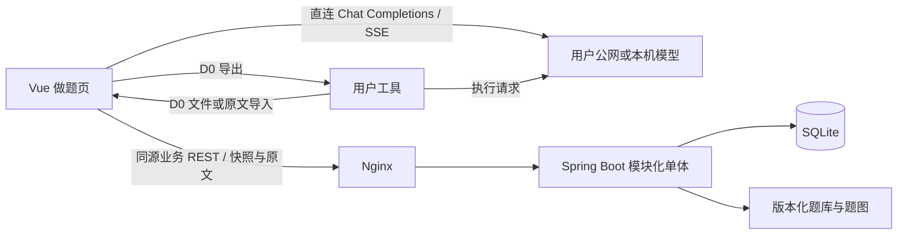

# 架构、数据与部署

> 来源：原方案 v0.2 第 3 节。拆分保留原意；示例不是已经实现或验证的功能。

产品边界见 [PRODUCT](PRODUCT.md)，判题见 [JUDGE](JUDGE.md)，资源配额见 [TESTING](../TESTING.md)。

## 3.1 分工与数据流

Vue 管理连接、凭据、请求预览、模型传输、导入导出与运行状态。Java 管理认证、题库、草稿、权限、运行记录和判题，依据冻结的题目版本及样例加载规则。后端按题库和允许编辑的 slots 规范化快照，不验证第三方是否执行了该请求。题目/样例/版本/账号等属于业务校验，模型来源、Model ID、结束原因等是用户侧提供的学习记录。

## 3.2 技术与模块

| 领域 | 首版设计 |
|---|---|
| 后端 | Java 21 LTS、Spring Boot + Spring MVC、Maven Wrapper、cn.shiinapple 包前缀 |
| 前端 | Vue 3、TypeScript、Vite，路由与中英 i18n，Fetch、AbortController、成熟 SSE 解析库，本地文件解析 |
| 数据 | SQLite 单机。验证 JDBC、迁移、WAL、事务、忙等待和备份恢复。Jackson 严格解析，Schema 库验证后锁定版本 |
| 安全 | Spring Security、同源会话、CSRF、XSS/CSP、登录限速和账号隔离 |
| 部署 | Nginx 静态 dist 与 /api 同源转发，systemd 运行 Java jar |
| 推迟 | OkHttp、okhttp-sse、SseEmitter 模型转发、模型请求线程池与出站隔离随 P1 评审。凭据加密存储无首版需求 |

后端按 auth、problem、practice、judge、settings、common 模块划分；前端连接设置与 practice 运行逻辑独立。首版不部署模型网关、Redis、消息队列、独立 Node 服务或其他分布式组件。确切版本和依赖以联调和维护状态为准。

## 3.3 概念数据模型

| 实体 | 主要字段及约束 |
|---|---|
| users / user_settings | 邮箱唯一、passwordHash、可选 verifiedAt、账号状态、语言和编辑偏好 |
| problem_versions | problemId/version、内容哈希、发布时间。旧版本和受信资产不可覆盖 |
| drafts | userId/problemId/version、editableSlots、selectedCaseId、revision、updatedAt |
| prompt_snapshots | userId、problemId/version、caseId、slots、规范化 messages 或可重建引用、requestParams、createdAt。题图用版本化资产引用，避免重复写入 base64 |
| runs | userId、snapshotId、来源 DIRECT/D0、声明或客户端报告的 modelId、idempotencyKey、运行状态、可选原始完整正文、结束原因、故障码、verdict/checks、createdAt/finishedAt |
| submissions | userId、runId、submittedAt，同一次运行归档幂等 |
| email_verification / reset_tokens | 需要邮件能力时使用，存 token 哈希、用途、有效期和使用时间 |

连接配置留在浏览器。数据库不存 Base URL、API Key、connectionId、加密字段、可信等级、免费配额或预留结算数据。未完成记录以过期状态收敛，终态只由首次有效提交设置，用户可重新运行。所有查询按用户授权，保留期和账户删除策略见 [决策记录](../DECISIONS.md)。

## 3.4 API 与运行时序

| 方法与路径 | 用途 |
|---|---|
| POST /api/auth/login、/logout | 首版供预建账户登录和退出；公开自助注册、邮件验证与找回后置 |
| GET /api/me；GET/PATCH /api/settings | 账号和非敏感偏好 |
| GET /api/problems；GET /api/problems/{id} | 题库、题目版本、编辑槽与公开样例 |
| GET/PUT /api/problems/{id}/draft | 草稿，revision 防覆盖 |
| POST /api/runs | 校验题目版本、用例、slots、模式，返回 runId 和规范化快照，按用户及幂等键去重 |
| POST /api/runs/{id}/result | 提交完整原文与必要的模型元数据判题，或提交取消/故障状态及脱敏代码 |
| GET /api/runs/{id}；GET /api/problems/{id}/runs | 本人运行详情和题目历史 |
| POST /api/submissions；GET /api/submissions | 归档已判题的运行、查看归档 |

创建快照后浏览器按快照组装 payload，执行直连或 D0 导出。直连取消在浏览器完成，必要时上报状态。D0 文件处理、模型列表和连接测试也由浏览器完成，无服务器模型连接 CRUD、模型事件订阅、上游取消与文件上传端点。结果事务原子写入，重复提交同一结果返回既有结果，改交另一份正文须新建运行。页面断线重连可查询已有结果，正在运行的浏览器流不能跨刷新续接；不得静默重发推理。服务端拒绝越权、未知字段、不合法输入、超大正文和非法状态变更；错误返回 code、messageKey、安全 details、requestId。

## 3.5 账户、资源与部署

同源 Cookie 使用 Secure、HttpOnly、SameSite=Lax，修改请求启用 CSRF。使用 Spring Security PasswordEncoder、登录限速、会话轮换与合理 TTL。邮箱规范化避免擅自删除加号或点号。首版由项目所有者预建内测账号。公开自助注册与找回后置，届时核对邮件服务与验证流程。日志只记录必要的业务元数据，严禁记录凭据和完整请求体，不开启生产调试端点。

2 核 2 GB 环境中，将 SQLite、Java 和 Nginx 部署在同一主机，静态资源在构建环境产出。通过模拟用户请求测试 JVM RSS、CPU、事务并发、磁盘增长和备份恢复；限制 API 请求体及判题负载，配置日志轮转。备份使用 SQLite 一致性备份方式并做恢复演练。运行途中重启允许客户端查询快照和提交待判正文，过期运行可从草稿重新建立。没有平台模型 SSE 路径，无需专门配置 Nginx 的模型流式转发。具体 JVM 配额、正文大小、历史留存期按同规格验证结果确定。

完全新建项目。候选依赖以 PoC 验证为准，正式界面的 Design Token 按 UI 文档单独核对。建议 frontend/、backend/、content/、deploy/、docs/，后端业务包按模块组织。
