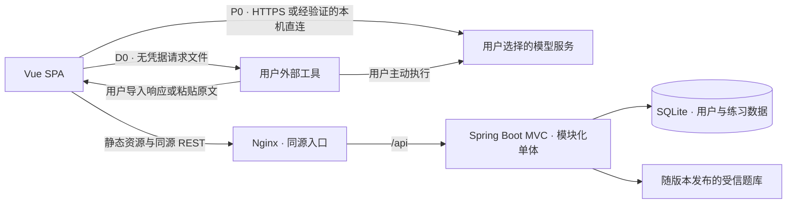
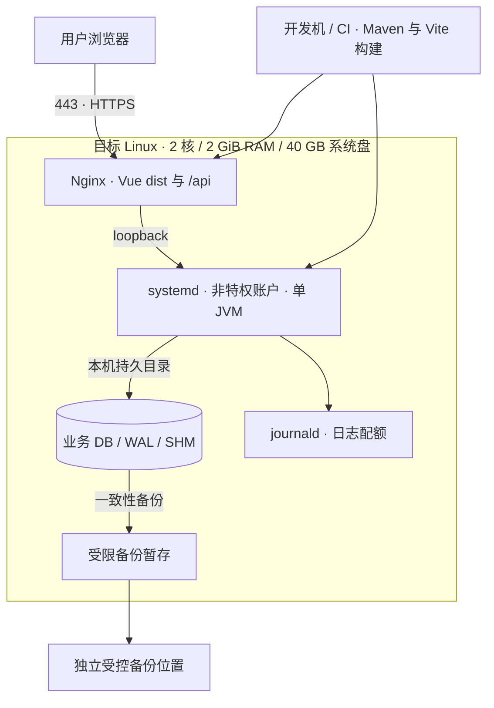

# 正式工程架构

2026-11-25 · 架构评审稿。所有者已确认开发方向、技术组合和既有产品边界。下文的具体结构是实施建议，架构确认后进入 [M0](../tasks/M0.md)。实验证据、待验证项和需要所有者决定的事项分别见 [TESTING](../TESTING.md) 和 [DECISIONS](../DECISIONS.md)。

## 系统逻辑架构



用户可手写 Prompt、使用 AI 生成或使用外部工具修改。固定消息和公开输入用于控制测试条件，用户可编辑的槽不检查写作方式。一次运行冻结一个公开用例，Java 对原始答案评估正确性。稳定性看同条件重复或跨用例的结果分布，效率看有记录的延迟、用量等指标。首版逐次记录，缺失值显示未知，模型 ID、延迟和用量均标为客户端报告或用户声明。没有按 Prompt 写法计分，也没有跨设备、跨提供方的可信排名。[产品范围](PRODUCT.md) · [判题规则](JUDGE.md)

## 工程目录与依赖方向

```text
backend/                         # 单 Maven 模块，Maven Wrapper，Java 21
  src/main/java/cn/shiinapple/promptpractice/
    auth/                         # 登录、会话、用户主体
    problem/                      # 题库读取、版本、模板和用例
    practice/                     # 草稿、快照、运行、历史和归档
    judge/                        # 严格解析、Schema、用例断言
    settings/                     # 用户偏好
    common/                       # HTTP 错误、请求 ID 等技术共用
  src/main/resources/db/migration/ # Flyway 增量迁移
  src/test/                       # 单元、HTTP 与真实临时 SQLite 集成测试
frontend/
  src/app/                        # 应用入口、路由、i18n
  src/features/
    auth/                         # 会话与登录页
    problems/                     # 题库和题面
    practice/                     # 编辑、预览、D0 与运行编排
    history/                      # 运行记录与归档
    settings/                     # 用户偏好页
    model/                        # 连接设置、凭据和直连适配器
  src/shared/                     # 平台 API client、通用显示组件与样式
content/problems/                 # 版本化题目资源，构建时打包受信发布内容
deploy/                           # 到部署阶段添加 Nginx、systemd、备份操作文件
docs/                             # 架构、验证、任务、学习与交付
poc/                              # 独立实验与证据
```

| 模块 | 拥有的业务与数据 | 依赖 |
|---|---|---|
| auth | 用户创建、登录、账号状态、当前主体 | Spring Security、自己的用户数据访问 |
| problem | 题目资源、版本/用例目录、消息组装 | 受信内容、自己的目录数据访问 |
| judge | 原文解析、Schema 校验、确定性断言、结构化反馈 | Jackson、验证后的 Schema 库、调用方传入的受信规则；纯计算，无网络与 DB |
| practice | 草稿、冻结、终态、过期、本人历史、归档 | problem 的版本接口、judge 的判题入口、控制器解析的用户主体、自己的数据访问 |
| settings | 语言、编辑器偏好 | 当前用户主体、自己的偏好数据访问 |
| common | 请求 ID、错误格式、时钟或配置等已产生的共用基础设施 | Spring 与标准库 |

包内按实际需要组织 Controller、Service、Repository；Controller 做 DTO、身份与 HTTP 映射，Service 管业务状态和事务边界，Repository 用 JdbcClient/参数化 SQL。其他模块使用公开入口，表由所属模块维护，外键保护跨模块引用。题库规则在 CI 通过组合测试调用 judge 校验，运行时 problem 和 judge 无互相依赖。先用 Java 包边界和可见性，后续出现越界依赖再考虑架构测试工具或拆 Maven 模块。

前端 practice 编排状态并调用平台 API、model 直连适配器和 D0 文件适配器。model 持有连接和凭据，向 practice 只返回白名单结果。平台 API client 不接受网关配置；D0 文件在浏览器本地读写。题库/判题复用业务契约，页面共用现有 [Design Token](../../frontend/src/styles/tokens.css)，在需要完整界面时按 [UI](UI.md) 验收。Vite 本地代理 `/api`，生产构建成静态资源。

## 一次运行的数据流

1. 前端读取题目和公开用例，用当前草稿做即时预览。创建运行时 Java 校验版本、用例、slots、参数，并重新组装消息，在一个事务中写快照和 PENDING run。
2. 前端以 API 返回的规范化消息作为运行依据。直连按配置执行普通请求或 SSE，D0 复制或下载同一份快照的请求，再由用户导入或粘贴。切换方式保留草稿，按显式操作创建另一条运行。
3. 正常结束的完整 assistant 正文或用户确认完整的 D0 原文进入同一结果 API。Java 从快照选规则，严格判题并原子写入终态；取消或传输故障仅记录受限元数据。刷新查询既有运行，用户主动决定是否重新推理。
4. 历史关联原版本与用例，归档引用已判题的运行。数据库结构和写入竞态见 [数据模型](DATA_MODEL.md)，请求/响应及错误见 [REST API](API.md)。

直连先使用 Chat Completions 适配器。连接检查、列表、普通响应和 SSE 的协议处理留在 model 边界，D0 提取兼容响应或接收原文，两者只共享结果契约。新增同类协议时先增加适配器及四路径一致性用例。判题先实现 002 所需断言，再由新题推动新增白名单操作。改变凭据流向、引入非确定性判题、平台侧出站或执行工具，均需重新评审。[模型接入](MODEL_INTEGRATION.md) · [题目维护](PROBLEMS.md)

## 安全与信任边界

- 内测用预建账户，M4 提供本机运维入口，密码通过受控交付渠道分配，Spring Security PasswordEncoder 管哈希和参数，登录限速并使用统一失败提示。建议单 JVM 的 Servlet 会话，重启后重新登录，练习状态仍可查询。登录轮换会话，退出失效，生产 Cookie 使用 Secure、HttpOnly、SameSite=Lax。
- 所有业务写入及登录/退出启用 CSRF。SPA 通过同源 `GET /api/auth/csrf` 获取 token，放入指定请求头，启动、登录和退出后更新。验证跨账号访问、会话轮换及失效。M1/M2/本地 M3 的测试主体仅在显式本地环境启用并绑定回环地址，生产启动拒绝本地夹具配置。[Spring Security SPA CSRF](https://docs.spring.io/spring-security/reference/7.0/servlet/exploits/csrf.html)
- 从认证主体解析 userId，写入条件和查询都带用户约束；跨账号资源统一回复 404。题库只接受随构建交付的版本和规则，客户端提供的 Prompt、正文、模型标识、使用量、耗时与声明一律按不可信输入处理。平台能证明规则对提交内容的判定，对来源只作记录。
- BYOK Key 默认内存、显式可选 sessionStorage，清除/退出/切号时清理。直连请求使用目标绑定、拒绝重定向、无站点 Cookie；平台请求、导出和日志使用字段白名单。首版结果以纯文本展示，CSP 候选与本机例外在 M2 设计、M6 在目标条件下验收。
- 请求大小同时在 Nginx 与应用限制。应用按端点检查解析前实际字节、解码后的正文、JSON 深度和字段大小；判题采用有限规则和并发预算。受信 Schema 引用只在发行包内解析；所有者创作的新规则也走 lint 和 fixture。

## 部署与运行维护



| 项目 | 首版方案 |
|---|---|
| 进程和资源 | 一个受 systemd 管理的 Java 进程与 Nginx，构建在目标机外完成。JVM 候选 `-Xms128m -Xmx512m`，小池候选 1 idle / 4 max、busy timeout 1 秒从 PoC 起步；实测请求线程、判题并发、RSS、WAL 和磁盘余量再锁定。池大小不能提高 SQLite 的同时写入数。 |
| 配置 | 工程默认值、dev/test 与生产配置分开。生产地址回环，数据目录与发布目录分离。Nginx 只信任本机转发链的预期设置，由应用生成请求 ID。健康检查仅暴露必要状态，迁移及题库校验完成后才就绪，生产诊断信息不公开。 |
| 日志与异常 | 结构化日志记请求 ID、路由模板、HTTP 状态、耗时、故障码；超限/忙等待和认证失败做有限计数。预期错误按 API 映射，意外异常报 500 且内部留可定位的安全日志。Nginx/应用日志排除正文、Prompt、查询串、连接配置、认证头和 Cookie；按大小、周期、磁盘预算轮转。 |
| 备份 | 先用同一数据库连接机制运行 `VACUUM INTO` 输出到新文件，建议每日低峰及发布前备份。发布前测试活动写入时的一致性及 CPU/磁盘影响。限制权限，完整性检查后再移出主机，保留与备份对应的题库和构建版本。验收以独立目录恢复、外键/行数检查和关键业务读取为准。[SQLite VACUUM](https://sqlite.org/lang_vacuum.html) |
| 上线与回滚 | 发布前备份，停止旧服务，单一实例迁移并校验题库，再启动、测健康和真实 HTTPS 冒烟。应用回退先核对数据库和题库兼容性；不兼容时停写，从发布前的一致性备份恢复并明确停写后的数据影响。结合运行窗口验证日志轮转、磁盘告警、异常重启与回滚。 |

测试采用纯函数单元、真实 SQLite 集成、平台 HTTP 契约、浏览器 Mock E2E 和授权目标环境验收。默认测试不调用真实模型。2 核 2 GiB 容器 PoC 只覆盖短负载和测试表，目标机资源上限、实际系统盘 I/O、留存和备份恢复窗口仍待测。[验证分层与预算](../TESTING.md) · [POC-04](../validation/POC-04.md)

## 演进条件

写锁或 WAL 积压持续影响请求时，先测事务持续时间、读游标寿命、索引、池和 checkpoint。经调整仍达不到真实负载目标，或出现多实例/多写者需求，再评估 PostgreSQL。只有部署、故障或团队边界确实需要隔离时才考虑拆服务。D0 成本长期妨碍公网用户练习时才评估 P1；主要阻塞在用户本机且确有自动化需求时评估 P2。视觉题继续走独立发布门槛。
