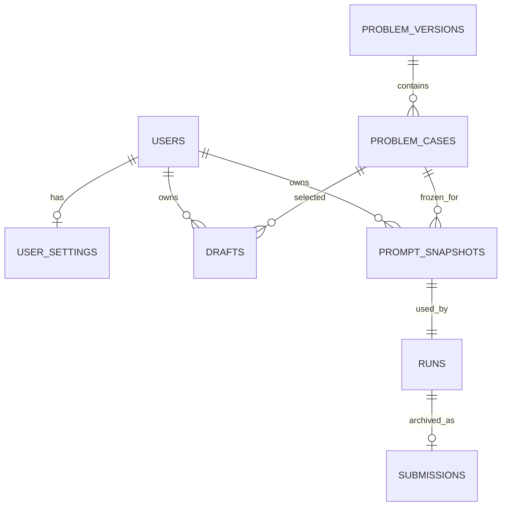
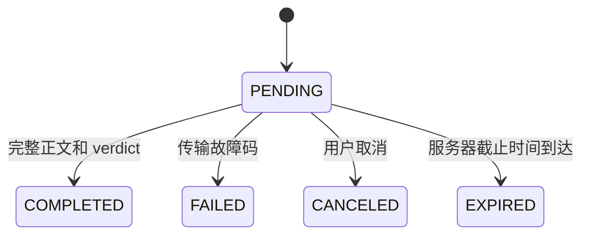

# 数据模型与事务

架构评审建议。DDL 用于评审和离线核对，正式迁移从 M1/M4 分段落地。时钟统一服务器 UTC，数据库用 Unix 毫秒，HTTP 用 RFC 3339。外部资源 ID 用应用生成的 UUID，题目、版本及用例使用受信题库 ID。

## 领域关系



稳定 problemId 可有多个不可变版本。SQLite 存可引用的版本和公开用例目录，规则、消息模板、翻译、静态资产在受信发行包中。草稿可编辑。快照保存当时实际使用的规范化消息和参数；资产使用带版本和摘要的引用。运行拥有独立状态，归档只引用一个已判题运行。程序在一个事务内创建或删除快照及运行，确保一对一；数据库保证至多一个 run 指向同一快照。

## 表结构与索引

下列以 M1 占位用户目录与练习切片、M4 账户和学习记录为界。M1 的本地夹具用户经显式配置生成。M4 先添加身份字段再启用真实认证，本地测试数据使用独立数据库。

```sql
-- M1
CREATE TABLE users (
    id TEXT NOT NULL PRIMARY KEY,
    created_at INTEGER NOT NULL
);
CREATE TABLE problem_versions (
    problem_id TEXT NOT NULL,
    version INTEGER NOT NULL CHECK (version > 0),
    content_hash TEXT NOT NULL,
    published_at INTEGER NOT NULL,
    PRIMARY KEY (problem_id, version)
);
CREATE TABLE problem_cases (
    problem_id TEXT NOT NULL,
    version INTEGER NOT NULL,
    case_id TEXT NOT NULL,
    PRIMARY KEY (problem_id, version, case_id),
    FOREIGN KEY (problem_id, version) REFERENCES problem_versions
);
CREATE TABLE prompt_snapshots (
    id TEXT NOT NULL PRIMARY KEY,
    user_id TEXT NOT NULL REFERENCES users ON DELETE CASCADE,
    problem_id TEXT NOT NULL,
    version INTEGER NOT NULL,
    case_id TEXT NOT NULL,
    slots_json TEXT NOT NULL,
    messages_json TEXT NOT NULL,
    request_params_json TEXT NOT NULL,
    created_at INTEGER NOT NULL,
    UNIQUE (user_id, id),
    FOREIGN KEY (problem_id, version, case_id) REFERENCES problem_cases
);
CREATE TABLE runs (
    id TEXT NOT NULL PRIMARY KEY,
    user_id TEXT NOT NULL,
    snapshot_id TEXT NOT NULL UNIQUE,
    mode TEXT NOT NULL CHECK (mode IN ('DIRECT', 'D0')),
    idempotency_key TEXT NOT NULL,
    create_digest TEXT NOT NULL,
    status TEXT NOT NULL CHECK (status IN ('PENDING', 'COMPLETED', 'FAILED', 'CANCELED', 'EXPIRED')),
    result_digest TEXT,
    raw_output TEXT,
    reported_meta_json TEXT,
    failure_code TEXT,
    verdict TEXT CHECK (verdict IN ('PASSED', 'FORMAT_ERROR', 'WRONG_ANSWER')),
    checks_json TEXT,
    created_at INTEGER NOT NULL,
    expires_at INTEGER NOT NULL CHECK (expires_at > created_at),
    finished_at INTEGER,
    UNIQUE (user_id, id),
    UNIQUE (user_id, idempotency_key),
    FOREIGN KEY (user_id, snapshot_id) REFERENCES prompt_snapshots (user_id, id) ON DELETE CASCADE,
    CHECK ((status = 'PENDING' AND finished_at IS NULL)
        OR (status <> 'PENDING' AND finished_at IS NOT NULL)),
    CHECK ((status IN ('COMPLETED', 'FAILED', 'CANCELED') AND result_digest IS NOT NULL)
        OR (status IN ('PENDING', 'EXPIRED') AND result_digest IS NULL)),
    CHECK ((status = 'COMPLETED' AND verdict IS NOT NULL AND raw_output IS NOT NULL AND checks_json IS NOT NULL)
        OR (status <> 'COMPLETED' AND verdict IS NULL AND raw_output IS NULL AND checks_json IS NULL)),
    CHECK ((status = 'FAILED' AND failure_code IS NOT NULL)
        OR (status <> 'FAILED' AND failure_code IS NULL))
);
CREATE INDEX snapshots_by_user_problem ON prompt_snapshots (user_id, problem_id, id);
CREATE INDEX runs_by_user_created ON runs (user_id, created_at DESC, id DESC);
CREATE INDEX runs_pending_expiry ON runs (expires_at) WHERE status = 'PENDING';

-- M4
ALTER TABLE users ADD COLUMN email_normalized TEXT;
ALTER TABLE users ADD COLUMN password_hash TEXT;
ALTER TABLE users ADD COLUMN state TEXT NOT NULL DEFAULT 'DISABLED'
    CHECK (state IN ('ACTIVE', 'DISABLED'));
CREATE UNIQUE INDEX users_by_email ON users (email_normalized);
CREATE TABLE user_settings (
    user_id TEXT NOT NULL PRIMARY KEY REFERENCES users ON DELETE CASCADE,
    locale TEXT NOT NULL CHECK (locale IN ('zh-CN', 'en')),
    editor_prefs_json TEXT NOT NULL,
    updated_at INTEGER NOT NULL
);
CREATE TABLE drafts (
    user_id TEXT NOT NULL REFERENCES users ON DELETE CASCADE,
    problem_id TEXT NOT NULL,
    version INTEGER NOT NULL,
    case_id TEXT NOT NULL,
    slots_json TEXT NOT NULL,
    revision INTEGER NOT NULL CHECK (revision > 0),
    updated_at INTEGER NOT NULL,
    PRIMARY KEY (user_id, problem_id, version),
    FOREIGN KEY (problem_id, version, case_id) REFERENCES problem_cases
);
CREATE TABLE submissions (
    id TEXT NOT NULL PRIMARY KEY,
    user_id TEXT NOT NULL,
    run_id TEXT NOT NULL UNIQUE,
    submitted_at INTEGER NOT NULL,
    FOREIGN KEY (user_id, run_id) REFERENCES runs (user_id, id) ON DELETE CASCADE
);
CREATE INDEX submissions_by_user_time ON submissions (user_id, submitted_at DESC, id DESC);

-- M6（D20）
CREATE TABLE account_deletion_requests (
    user_id TEXT NOT NULL PRIMARY KEY REFERENCES users ON DELETE CASCADE,
    requested_at INTEGER NOT NULL,
    effective_at INTEGER NOT NULL CHECK (effective_at = requested_at + 259200000)
);
CREATE INDEX account_deletion_due ON account_deletion_requests (effective_at);
```

说明：撤回即删除该行；到期任务删除 `effective_at <= now` 的 users 行，依赖外键级联删除关联数据。毫秒时间戳，3 天为 259200000。

- 主键/唯一约束承担查 ID 与去重。列表按用户、时间与 ID 使用游标。历史按 user/problem 过滤，经 snapshotId 连接，不在 runs 重复保存题目信息。M4 增加实际历史清理后，按查询计划和实测决定是否需要按 finishedAt 加索引。
- 持久化 JSON 只用于有界、不按内部字段索引的结构。应用验证结构和各字段白名单，原文 TEXT 保存且不改写。模型连接的 URL、认证头和凭据不进入持久化字段。应用创建 ACTIVE 用户时必须同时写入规范化邮箱和密码哈希，未填身份的本地夹具保持 DISABLED。邮箱规范化及唯一冲突在 M4 测试。
- Flyway 管结构迁移，受信题库目录在启动校验后以短事务注册版本与用例。已存在版本的摘要变更视为配置错误。不得发布缺少仍被引用的历史资源的构建；当前发布版本由发布清单选择，旧版只用于历史、草稿复制及完成此前创建且未过期的运行。历史资源和备份一同管理。
- SQLite 文件使用本机磁盘。初始化 WAL，每个物理连接启用外键及 busy timeout，迁移、业务池和测试均核对。WAL 支持读写并行，仍只有一个写者。短事务内避免模型、判题、文件和慢请求操作。[SQLite WAL](https://sqlite.org/wal.html) · [SQLite 外键](https://sqlite.org/foreignkeys.html)

## 状态、并发与删除



| 写入场景 | 事务边界与冲突处理 |
|---|---|
| 创建 run | 对校验后、补齐默认值的创建字段生成稳定摘要，按 userId 与 Idempotency-Key 去重。同键同摘要返回原 run，同键不同意图 409。核对受信目录并原子插入快照和 run。并发唯一冲突先回滚本次快照写入，再读取胜者记录。 |
| 写入结果 | 先按所有者读取不可变快照与现有终态；同一结果重试直接返回。必要时在写事务外做有界判题，首个条件更新胜出。条件包含 `id = ? AND user_id = ? AND status = 'PENDING' AND expires_at > ?`，使用取得写入机会后评估的服务端时间。DEFERRED 事务用第一条无数据变更的 UPDATE 抢占写锁，再取时间，避免 JDBC 在提交或回滚后自动重开 IMMEDIATE 事务引发的误报。结果、原文与反馈一起写。更新未命中则重新读：同终态意图 200，不同结果 409，过期 410，找不到 404。并发请求可能各计算一次判题，最多一次落库。 |
| 比较重试 | 摘要固定编码版本、字段顺序与默认值。结果摘要覆盖请求意图、原文及接受的客户端元数据，不包含服务端时间与判题反馈。原文按解码后的 Unicode 文本、原有换行与空白计算 UTF-8 摘要。来源来自 run.mode。 |
| 过期 | 服务端令超过截止时间的 PENDING 有效状态为 EXPIRED，GET 无需写入。维护任务可小批量 CAS 持久化 EXPIRED，finishedAt 取截止时间。过期永不接受新终态，创建重试只取回旧 run。执行截止时间默认 D0 24 小时、直连 10 分钟。 |
| 草稿 | 不存在时用 revision 0 创建 revision 1；已有时带精确 revision 条件更新并递增。冲突 409 返回服务器 revision，客户端先保留本地编辑。不同题目版本可并存，复制由用户主动触发。 |
| 归档 | 单条 `INSERT ... SELECT` 只从本人且 COMPLETED 的 run 插入，runId 唯一，同一 run 的重试读取原归档。归档、删除和留存清理由短写事务序列化；清理删除未归档快照前，在同一写语句或事务重查归档不存在。 |
| 删除与留存 | 清理以快照为删除入口，级联删除 run；归档移除只取消归档标记，再将 run 纳入未归档留存规则。用户提交删除申请后进入 3 天反悔期（期间可撤回），反悔期结束后删除账户及其关联数据（见 D20），未归档的终态运行自 finished_at 起保留 30 天，过期运行的 finished_at 取截止时间。已归档运行和草稿不参加定时清理。独立备份按备份轮换策略保留。 |

SQLite busy 超时耗尽时映射为 503，前端可重试同一业务写入意图。客户端运行状态在不确定时先读 run，以免为取回结果重复调用模型。幂等保证限于运行记录存在期间，超过留存窗口不重放原创建请求。
